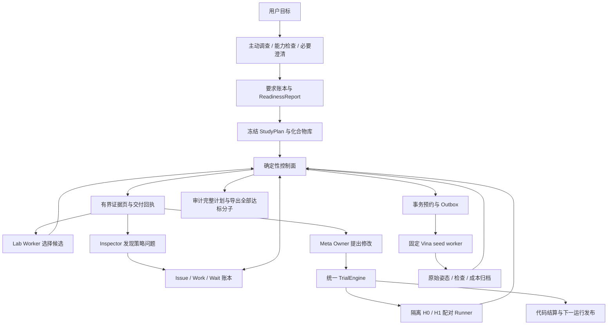

# RSI-Lab Docking 专用编排设计

版本 1.2 · 2026-11-05 · 状态为待实现的专用设计。1.1 补充化学准备与相互作用证据。1.2 增加主动任务调查、缺口发现、用户澄清与能力验证，用户无需先列出 pH、氢键等专业前提。本文不报告新的实验结果。

本设计将领域中立编排规格落实为固定候选库上的 AutoDock Vina 筛选系统。Lab 决定下一批评价哪些分子，Meta 提出有范围限制的策略修改，控制器负责身份、执行、预算、证据和发布判定。正式输出必须包含至少 **100 个不同且达标的 compound**。现有 **20 选 5** 的演示和 pilot 保持独立。

设计依据为外部文档《通用编排最终设计 v1.0》（文件名 `AGENTIC_ORCHESTRATION_FINAL_DESIGN.md`，未随本仓库分发），源文件 SHA-256 为 `cacebe0bc0c1c1fa409802feb1d2566058f50c4cdd411e9b65bab3d202543696`。本文沿用其控制面契约，并明确 docking 的领域约束与首版能力子集。引用稿中的实现要求用于制定本设计，不代表这些能力已在当前仓库完成。

当前可执行接口见 [Lab harness v1](lab-harness-v1.md) 与 [真实 agentic 闭环](live-agentic-study.md)。后者已提供 Owner/Inspector、自动配对执行与单状态配体准备的首版实现；本文的 `DockingStudyPlan`、SQLite 控制面和更完整的领域能力仍是设计目标，不能全部当作已有 CLI 使用。各节保留设计提出时的基线描述，实际能力与限制以运行说明及归档为准。

## 1. 任务定义与版本边界

首版任务固定为 CDK2 / CHEMBL301、`1DI8_chain_A`、单一冻结受体与结合位点、独立 AutoDock Vina 1.2.7、`scoring=vina`。输入为合法且有固定身份的候选库、公开证据快照、计算协议和有限预算。Worker 从候选库选择分子，不生成库外 SMILES，不在运行中更换受体或扩充候选库。

| 模式 | 任务与输出 | 可以验证的结论 |
| --- | --- | --- |
| `replay_demo` | 保留合成 20→5 闭环与 Meta 演示 | 软件流程可回放，标记 `demo_only` |
| `live_pilot` | 保留真实 20→5、最多 8 项在线评价及最多 5 项独立 terminal 名额 | 小规模工具和交互闭环，不能产出正式 100 项名单 |
| `formal_screening` | 在冻结候选库与预算内完成筛选，导出所有达标且去重的分子 | 达成或未达成正式名单约束 |
| `paired_validation` | H0 / H1 在同起点、同评价协议与同额度下独立运行 | 指定任务范围内的配对策略效果与成本 |

`phase=development|validation|final` 与上述模式分开。development 可产生 Meta 候选，validation 只执行冻结的验证计划，final 使用已冻结策略且关闭新的策略修改。小规模 validation 可以验证机制，不能被登记成“正式名单效果已验证”。

正式版是新运行 schema，不把旧 20→5 campaign 的上限直接调大。实验方案中历史的 `N=100、k=10` 等规模也不作为本设计的正式名单配置，因为它们无法保证 100 个合格输出。

### 1.1 系统先发现任务前提，再接受执行计划

用户可以只提出“用 Vina 为该靶点筛选至少 100 个 compound”。系统负责把这个目标展开成可验证的任务要求，主动检查数据、方法和能力是否足够。不能要求用户预先知道并列齐化学准备步骤，也不能等用户指出某个名词才登记相应缺口。

任务调查沿用 Owner 和 Inspector 的调用模式，增加 `scope=intake`。它包含两类互补检查。

- **登记的领域要求**覆盖已知常见前提，例如任务目标、分子身份、结构与化学准备、评价语义、预算和验证。每项须判断适用性和证据，不能只检查文件字段非空。
- **针对当前任务的开放式审查**结合实际输入、异常、工具适用范围和一手资料，提出尚未列入模板的条件。Inspector 从“哪些假设即使软件跑通也可能令结论失效”审查 Owner 的方案。模型提出新要求后仍由类型化记录、证据与 validator 管理，不获得任意改协议的权限。

例如用户未提 pH，系统仍应检查目标实验条件和准备状态来源。用户未提氢键，系统应判断所需交付是否需要相互作用证据、现有工具能否提供。若目标仅为固定协议能量筛选，氢键报告可为辅助能力，不因发现一个可能相关的方法就把它自动升级成硬入选条件。

### 1.2 有预算的主动补全闭环

```text
用户目标与已有授权
  → 冻结 IntakePlan
  → 盘点数据、任务依赖和实际可用工具
  → 提出并核验 TaskRequirement / CapabilityGap
  → 自主查证、调用已有工具、必要时询问用户
  → Inspector 审查遗漏与矛盾
  → 形成 ReadinessReport
  → 满足任务准入要求后冻结 StudyPlan
```

`IntakePlan` 是正式 StudyPlan 之前的独立调查计划，冻结目标、已有约束、可访问来源、模型/工具路由、权限，以及有限的调用、token、传输和墙钟预算。可复用已有授权和登记的调查额度，不要求用户逐个批准普通读取或可逆检查。没有额度时先形成静态缺口报告，不能无上限地递归调查。

调查也使用相同账本、先预约再执行的 Effect 协议和证据回执。TaskIntake 本身是本地协调器，不持有包住模型和工具的额外执行租约。外部资料是待核对证据，不能通过其中的指令扩大权限。首版不派发生产候选评分。必要的准备探针、参考配体校准或方法比较须有独立登记配置和额度，结果标记为 development/calibration，不能混入正式最终名单。这样既允许先查清楚任务，又不形成“StudyPlan 必须完整后才能查如何填写 StudyPlan”的循环。

`TaskRequirement` 至少包含 `requirement_id, statement, applicability, impact, dependencies, evidence_refs, capability_refs, resolution_criterion_id/version, resolution_status, resolver, decision_ref, affected_scope`。状态区分 `unresolved, source_supported, tool_checked, user_declared, assumed_allowed, contradicted, not_applicable`。来源、工具检查与用户陈述是不同证据类型，都不等于已经获得科学真值。假设只有符合预登记的假设策略且显式记录时才可满足相应要求。

`CapabilityGap` 区分工具未安装、执行器未接入、缺输入、缺权限、适用范围不符和未验证。`ReadinessReport` 由代码按登记的 resolution criteria 汇总，保存这些记录、输入版本、已执行检查、已知未决项、允许的运行模式及 `ready|needs_input|needs_capability|needs_resolution`。它核验已登记的准入义务，不替代对科学判断的证据核对。若多个问题并存，报告全部原因，不能只显示一个掩盖其他义务。

| 缺口类型 | 系统应采取的动作 | 升级条件 |
| --- | --- | --- |
| 现有文件或连接源可回答 | 先读 assay、结构、准备日志和已有用户上下文，核对对象与条件 | 来源互相冲突或不适用于本构建体时保留冲突 |
| 公开方法或事实尚不清楚 | 查询官方工具说明、一手结构/实验资料，归档支持与限制 | 检索预算内仍无可靠信息时明确未找到，不补造 |
| 已有工具能确定 | 运行范围内的结构检查、准备检查或登记诊断，保存实际结果 | 执行失败、unknown 或不支持时转 CapabilityGap |
| 只有用户掌握的条件或偏好 | 提出具体问题，例如真实实验条件、是否要求复现实验、可接受的成本/任务范围 | 只阻塞依赖该答案的工作，其他调查继续 |
| 用户也不知道的技术条件 | 给出有依据的方案、假设与可验证步骤，在已有授权及预算内推进 | 没有可辩护方案时保留 needs_resolution，不让用户随意猜专业参数 |
| 缺少必要工具能力 | 查实际工具能力，选择已验证替代或形成具体接入任务 | 新适配器需实现、测试和登记后才能调用，不能仅在 prompt 中宣称支持 |

不保证发现所有未知问题。readiness 只表示在声明的任务范围、数据版本和检查覆盖下，已知必需义务有可核验去向。新证据、数据更新、工具失败或条件变化会使受影响要求重新待核验，不能因为某次模型写了“准备充分”就永久通过。

### 1.3 向用户提问的规则

只把不能从授权来源解决、且答案会影响任务目标、正确性、预算或权限的问题交给用户。系统负责解释缺什么、已经查过什么、为什么影响选择、建议方案及其代价。优先询问用户掌握的目标和约束，避免要求非专业用户选择具体原子类型、残基状态或计算软件参数。

相互依赖的必要问题合并提出，已有答案不重复问。例如找到一个 pH 数字前，必须确认它确属目标 assay，而非把其他实验的条件当作当前条件。若仍查不到，则围绕“复现已知实验还是开展明确假设下的探索”说明可行路径，而不是默认填入 7.4。

`ask_user` 是 intake/Owner 的新增类型化命令，注册后创建 Clarification Request 和依赖该 Request 的 Wait。提交问题不会占据外部任务租约。回复作为有来源的用户事件记录，经过对象和版本校验后只唤醒相关工作。deadline 只触发一次等待处置，不会把没有回复变成同意、事实或允许扩大预算。

可逆且不依赖答案的调查继续执行。若仅为可选偏好，可依据事先允许的默认策略继续并明确标注。涉及必要事实、科学假设边界或新增权限时，不能用等待时间代替答案。新答案与既有记录冲突时保留两个版本并解决冲突，不能静默覆盖。

### 1.4 “自动补能力”的执行边界

系统应能主动提出缺少的能力、寻找可用工具、构造适配方案与验证样例。在已授权的开发环境中，可以由工程代理完成独立适配器的实现和测试，然后登记版本、适用范围、输入输出、成本、恢复与验收回执。

这条开发路径与正式实验中的 Meta 权限分开。当前设计的 T3 仍关闭，实验运行内不能下载并执行任意新代码。必要依赖的接入尚未完成时返回 needs_capability，并给出可执行的缺口任务。只有受验证的能力实际注册后，Lab 才能使用。

Meta 可以从多次 intake 和执行问题中提出改进发现模板、来源选择、澄清时机和证据投影的候选版本，并用独立任务 fixture 验证。一次用户提醒形成有范围的经验，不能直接写成适用于所有靶点的科学规则。评价协议冻结后发现重大科学缺口时，登记问题并停止依赖它的正式工作，形成新协议研究，不在当前 H0/H1 比较中悄悄改变计分条件。

## 2. 评分、阈值与至少 100 项的共同目标

### 2.1 分子级评价

对化合物 $c$，冻结两个 Vina docking seed $S=\{17,43\}$。每个 seed 只取原始 PDBQT 的 `MODEL 1`。令 $E_{c,s}$ 为该姿态的 Vina affinity，单位 kcal/mol。

$$
V_c = \bigwedge_{s\in S}
  (\text{completed}_{c,s}\land\text{identity\_preserved}_{c,s}
   \land\text{pose\_valid}_{c,s}\land\text{finite}(E_{c,s}))
$$

$$
q(c)=\begin{cases}
\operatorname{median}(E_{c,17},E_{c,43}),&V_c=\mathrm{true}\\
\mathrm{missing},&\text{otherwise}
\end{cases}
$$

只有两个值时，这个中位数等于两者平均值。它是固定双 seed 的汇总，不是可靠性置信区间。另存两 seed 差值和全部原始姿态，首版不新增未经校准的差值淘汰门槛。

Vina 原始能量越低越好。若界面需要“分数越高越好”，只使用明确命名的 `utility = -q`，并保持 `utility >= t` 与 `q <= -t` 完全等价。原始记录和正式筛选仍使用 `q`，不能把正向分数阈值与能量上限混用。

### 2.2 正式输出集合

令 $D_a$ 为一个正式实验臂中，全部计划运行实际评价过的不同 compound。冻结能量上限 $\tau$，定义

$$
F_a(\tau)=\{c\in D_a: V_c=\mathrm{true}\land q(c)\le\tau\},\qquad
N_a=|F_a(\tau)|\ge100.
$$

正式导出**整个集合 $F_a$**，依能量、稳定 compound key 排序。若有 137 项达标就导出 137 项，不只保留最好 100 项。模型的推荐名单只作解释，不决定哪些已测达标分子进入正式导出。数量条件独立于均值，99 个非常好的分子仍是未达标。

`mean_selected_energy` 是 $F_a$ 中所有分子的平均 $q$，空集合记 missing。失败、未测和未知单列，不填成 0 kcal/mol，也不当成较差但有效的能量。compound 的能量 cutoff、Trial 的 minimum effect 和姿态有效性规则使用不同字段，不能以一个笼统 threshold 互相替代。

100 项约束作用于**每个正式实验臂的输出**。两个各 50 项的验证臂不能合并过线，也不能把不同受体、不同协议、development 与 final 的结果拼成一份成功名单。一个实验臂可预先划分多个候选库 shard，必须事先登记全部 shard 与运行 ID，再统一去重。

### 2.3 阈值必须在观察验证结果前冻结

提高正向 utility 阈值，等价于降低 Vina 能量上限，通常会减少入选数量。阈值可以在 development 的校准研究中比较，但对 H0/H1 验证及 final 必须冻结同一个值、单位、方向和校准来源。`-7.0` 仍仅是现有文档的格式示例。

若数量不足，系统报告 shortfall，继续使用尚在计划与预算内的候选，或以欠量结束。它不能自动放宽阈值、降低姿态要求、添加 seed 后挑最好结果、临时增加预算或混入新运行。需要新阈值时创建新的 study，保留原 study 的未达标结果。

### 2.4 运行前的必要可行性检查

正式 study 必须满足 `eligible_unique_compounds >= 100`、`compound_evaluation_limit >= 100`，以及足以预约 100 对 seed 作业的额度。它们只是必要条件。库里恰好 100 个分子意味着任何一次不达标都会导致欠量。

预算规模由 development 的准备成功率、双 seed 姿态有效率、过阈值比例及实际耗时估计，记录不确定性。本文不自动扩大现有 pilot 预算，也不承诺任何有限库一定产生 100 项。

## 3. 冻结的 StudyPlan

新增 `DockingStudyPlan`，在 readiness 完成后、启动第一条正式实验调用前写入不可变 blob 并登记哈希。此前的调查调用归属独立 IntakePlan。正式 selector 读取该计划和控制器账本，不接受事后任意挑选的成功运行清单。

| 字段组 | 必须冻结的内容 |
| --- | --- |
| 研究身份 | `study_id, schema_version, mode, phase, parent_study_ref?` |
| 任务 | `target_id, construct_id, catalog_hash, public_evidence_snapshot_hash` |
| 分子身份 | `identity_policy_id/version, compound_registry_hash, prepared_state_manifest_hash` |
| 评价 | `scientific_profile_hash, evaluator_id/version, executable_hash, runtime_hash` |
| 筛选 | `energy_threshold, units=kcal/mol, direction=lower, min_final_compounds=100, export=all_passing` |
| 运行全集 | `expected_run_ids, shard_membership, pair_ids, arm_ids, execution_order` |
| 策略与模型 | `initial_policy_hash`、允许的策略变化模式、模型路由/版本、推理设置、tokenizer/version |
| 资源与停止 | 每臂评价、seed 作业、调用、token、工具、墙钟额度，停止与取消规则 |
| 分析 | `metric_registry_version, analysis_plan_id, primary_metric, guardrails, missing_rule` |
| 生命周期 | `registered_at_event, activation_event, development/validation/final_split_manifest` |
| 调查与准入 | `intake_plan_hash, readiness_report_hash, requirement_manifest_hash, capability_registry_hash, assumptions_policy_hash` |

启动只接受完整具体值，不能用 TBD 或模型猜测补齐。哈希固定输入内容，注册事件固定“先登记、后执行”的顺序。单独给事后 manifest 算哈希，不能证明预登记。

development 可按预先允许的 live_mechanism 范围追加 activation lineage，StudyPlan 的 initial_policy_hash 不变。validation/final 默认 `policy_change_mode=frozen`，每臂实际策略必须始终匹配其冻结哈希。将来研究动态 Meta 时要显式注册 bounded_live 的编排策略、权限和预算，不能把普通验证计划解释成已授权动态修改。

本地文件哈希用于检测漂移和对账，不提供抵抗管理员重写全部文件的独立时间证明。需要对外的预注册证明时，在执行前将计划哈希保存到独立受控记录。

selector 必须逐项报告计划运行的 `completed/failed/not_started/unknown`。已完成的失败结果可用于确认名单欠量，未完成计划不能靠删除运行 ID 变成完整结果。跨臂、跨阶段、额外运行和不兼容协议均拒绝导入。显式中止产生新事件，不能修改原计划。

## 4. 化合物身份与固定准备过程

### 4.1 三层身份

| 身份 | 用途 | 不得混淆 |
| --- | --- | --- |
| `source_compound_id` | ChEMBL 或供应商等原始编号，可有别名 | 多个来源编号不等于多个分子 |
| `compound_key` | 正式列表计数、全历史查重、数据切分 | conformer、seed、pose 和重复准备不增加计数 |
| `prepared_state_key` | 本次具体立体结构、电荷/质子化状态、互变异构状态及准备版本 | 不允许多个准备状态各算一个 compound |

当前代码以 RDKit 的 canonical isomeric SMILES 及准备回执检查具体结构，已通过 `chemical_states.json` 关联 source parent 与单一 prepared state。新设计将此关系扩展为完整 compound registry，将来源别名和准备状态映射到统一 `compound_key`。

首版不在线枚举质子化或互变异构体。盐型、互变异构和质子化形式的归并规则必须由版本化上游标准化器或经核对的 registry 提供，并有 fixture 验证。不能声称仅做 canonical SMILES 就已完成这些归并。保留已明确立体信息，不把所有同骨架结构粗暴合并。映射存在未决冲突时，正式启动失败。

正式库每个 compound 只允许一个冻结准备状态。未来多状态对接需要新的状态聚合与成本协议，不能取多个状态的最好分数并沿用本版评价器。

### 4.2 查重与评价身份

```text
compound_identity = (identity_policy_version, compound_key)
evaluation_identity = (branch_id, compound_identity, scientific_profile_hash)
seed_job_identity = (evaluation_id, prepared_state_key, vina_seed)
```

哈希作索引，命中后核对规范化内容。身份状态至少包含 `eligible, reserved, completed_valid, completed_invalid, failed, unknown`。同一臂的 reserved/unknown 不能重复准入，已完成失败也不能换别名重试以挑选幸运结果。

control 与 treatment 可评价相同分子，但各自拥有评价身份和预算。全历史查重在本分支及其继承 checkpoint 内成立，不跨实验臂阻止公平的独立评价。继承记录明确标为 inherited，不计作新增产出。

数据切分统一使用 `compound_key`。若声称骨架泛化，还需登记独立的 scaffold split。100 个不同分子不保证 100 个不同骨架，首版报告骨架覆盖，不把它擅自追加为用户的硬约束。

### 4.3 准备过程

复用当前单结构解析、RDKit ETKDGv3、固定 embedding seed `20261019`、MMFF94s 最多 500 次迭代且须收敛、Meeko 单一 setup 与原子映射。输入、准备 SDF/PDBQT、包版本及准备失败均保存。

受体 PDBQT、有效受体 PDB、参考配体、搜索盒和所有上游准备说明须在 study 前冻结。Worker 不做临时受体处理，Meta 不通过改变准备规则改善分数。准备过程中的未知项须明确列出，正式准入按下节检查，不能仅因文件存在或 Vina 能运行就认定准备完整。

### 4.4 加氢、质子化与受体准备是独立能力

“加氢”是为已经指定的化学结构补充氢原子。“选择质子化/互变异构状态”决定要使用哪种化学结构。“分析氢键”则是对给定复合物姿态检测供体、受体与空间几何。三者分别登记能力和证据，不能用其中一项替代另外两项。

当前配体路径在 `Chem.AddHs`、3D 构象生成与 Meeko 参数化之前，已增加 MolScrub 0.3.2 的固定 pH 7.5–8.0 规则准备，仅接纳唯一保留状态；这不是微态占比或可靠分子专属 pKa 的预测。方法和局限见[真实闭环说明](live-agentic-study.md)。Meeko 的配体准备接口需要已有氢原子和 3D 坐标，本身不替调用方完成这两项工作。[Meeko ligand preparation](https://meeko.readthedocs.io/en/develop/lig_prep_basic.html)

当前 CDK2 受体来自既有离线准备。数据包各 cohort 的 `receptor/receptor_manifest.json` 记录了 Meeko 处理，同时明确采用默认残基模板、没有 pH 状态集合、省略全部晶体水、未重建缺失 loop，并删除不完整残基 A:36、A:150、A:162；数据位置见[发布与复现说明](publication-and-reproduction.md)。它是有明确近似的 pilot 输入。当前 harness 校验并消费这些文件，没有自动执行完整受体准备，也没有验证这些近似足以支撑正式筛选。

新增 `PreparationManifest` 与 `preparation_readiness`，作为 StudyPlan 的科学前置输入。最少包含下列内容。

| 对象 | 必须提供的信息与处理记录 |
| --- | --- |
| 目标结构 | 结构来源、链/构建体、序列与残基编号映射、参考配体和坐标框架 |
| 受体完整性 | 缺失原子/残基、替代构象、实际修复或删除、对口袋的影响与未解决项 |
| 受体化学状态 | 质子化假设、相关残基状态、加氢方法、原子类型、准备工具/版本与输入输出哈希 |
| 水、离子与辅因子 | 保留/删除清单及依据，是否建模水桥、金属配位或其他特殊情况 |
| 配体状态 | compound/prepared-state 映射、形式电荷、立体化学、质子化和互变异构状态来源 |
| 环境假设 | 目标 pH 或明确标注未知的依据，状态选择策略及其适用范围 |
| 几何与校准 | 构象/优化设置、结构检查、参考配体 redocking 等登记校准及局限 |

能力注册区分 `import_prepared_receptor` 与 `prepare_receptor`。前者仅导入经核对的产物，后者必须实际调用已注册准备工具并保存完整回执。现有实现只有前者及基本配体准备。上游可使用 Meeko receptor 工具和登记的状态准备工具，但缺失环建模、状态推断、金属或共价体系不能自动视作其已支持能力。[Meeko 基础准备流程](https://meeko.readthedocs.io/en/develop/tutorial1.html)

`preparation_readiness=ready|needs_resolution|unsupported` 由登记检查与核对回执确定。required 字段缺失或影响任务的化学问题未解决时，正式运行不能启动。未知 pH 不能默填 7.4，可以通过明确登记单一输入状态、适用范围和限制进行研究，是否满足该 study 的准入要求须事前确定。

准备选择在观察候选 docking 分数前冻结。首版每个 compound 仍只有一个准备状态。多状态准备研究须先定义聚合、分子去重与预算规则，再建新协议，不能靠选择得分最好的状态提升当前评价。

## 5. 不可变的 AutoDock Vina 评价器

| 项目 | 首版专用协议 |
| --- | --- |
| 引擎 | 独立 AutoDock Vina 1.2.7，保存 `--version` 回执与 binary SHA-256 |
| 评分 | `--scoring vina`，不混用其他 scoring function |
| 受体 | CDK2 `1DI8_chain_A`，全部文件内容哈希 |
| 搜索盒 | 从现有冻结协议读取 center 与 size，单位 Å |
| 搜索设置 | `cpu=2, exhaustiveness=4, num_modes=3` |
| 随机性 | docking seeds `[17,43]`，准备 seed 单独记录 |
| 超时 | Vina 180 秒、单 seed worker 300 秒，重试 0 |
| 姿态选择 | native `MODEL 1`，不得在检查失败后换 MODEL 2/3 |
| 身份验证 | Meeko 映射回原配体，检查 canonical isomeric identity 与冻结输入一致 |
| 姿态资格 | 冻结 PoseBusters 配置的全部 required checks 明确为 true |
| 分子汇总 | 两 seed 均完成、身份保持、姿态有效后才有合格中位能量 |

上述计算量来自现有工程 profile，尚不表示已校准为 CDK2 的最佳搜索强度。改变 exhaustiveness、box、受体或资格规则属于新评价协议，不是同一实验中的 Harness 改进。

Vina 原生输出提供以 kcal/mol 表示的 affinity。PDBQT 到 SDF 的恢复使用 Meeko 保存的原分子信息，这与官方工作流一致。[AutoDock Vina 基础对接与结果导出](https://autodock-vina.readthedocs.io/en/latest/docking_basic.html)

PoseBusters 提供姿态合理性检查。本设计将选定检查及参数冻结为计算资格条件，不把通过检查解释为真实生物活性验证。[PoseBusters 官方实现](https://github.com/maabuu/posebusters)

`false` 是明确不合格，required check 缺列、不可解析或 unknown 不能视为通过。无实验参考姿态的普通候选，不添加 native-pose RMSD 门槛。共晶配体 redocking 可作为独立协议校准，成本和资格规则另行登记。

每次 seed attempt 必有 job_spec、持久执行意图、状态、费用完整性及 result manifest。`engine_receipt, argv, stdout/stderr, exit_status, ligand.sdf, ligand.pdbqt, poses.pdbqt, top.sdf, pose_checks.csv` 按实际完成阶段保存，并记录 artifact hashes。准备失败或超时导致未产出的文件必须标注 missing 与原因，不能为了满足格式补造。

原生解析器校验 MODEL/ENDMDL 结构、连续 rank、有限且有序的 affinity，以及每个 model 至少存在原子记录。分子恢复与身份检查由 Meeko/RDKit 完成，再核对所选 rank、SDF 属性和原始 affinity。`num_modes=3` 是搜索请求，不能要求输出必定有三个完整 mode。

结果真实性核验与科学有效性分开。原始文件及回执能支持“该冻结执行产生了这些计算结果”，不能支持“该分子已经被实验确认为 hit”。

### 5.1 对接后的氢键与相互作用证据

Vina 的评分已包含氢键相关项，但 affinity 不提供逐残基的相互作用报告。其官方说明还指出，输入质子化会影响供体/受体识别，而输出氢坐标不宜直接当作可靠的氢键几何依据。[Vina FAQ](https://autodock-vina.readthedocs.io/en/latest/faq.html)

新增 `analyze_interactions` 注册工具，初版设计采用 ProLIF 适配器，固定版本和检测参数后再启用。它基于实际受体与配体姿态返回氢键、疏水接触、盐桥和芳香相互作用等证据。ProLIF 支持相互作用类型及原子索引、距离、角度等元数据。[ProLIF interaction fingerprint](https://prolif.readthedocs.io/en/stable/source/modules/interaction-fingerprint.html)

每次分析必须绑定 `evaluation_id, seed, model_rank=1, receptor_state_hash, ligand_pose_hash, analysis_profile_hash`，结果含 `residue_id、protein/ligand atom mapping、interaction_type、distance、angle（适用时）、检测规则、来源与局限`。参考配体使用同一分析配置，模型才可比较实际计算的接触模式。两 seed 一致只表示这两次姿态的一致，不能解释成 MD 占有率或结合稳定性。

显式氢键几何分析前，需用冻结方法在保持对接重原子坐标的条件下重建/处理氢，并保存处理前后的结构与映射。受体分析输入应包含可核验化学拓扑与所需氢，不能假定当前 `receptor_effective.pdb` 已经提供这些信息。若选择工具的隐式氢检测模式，也须单独固定模式并标注其几何语义，不能混用两种结果。所需化学信息不足则报告 analysis_missing。

此工具在当前代码中**尚未实现**。首版相互作用分析是有预算和来源的辅助证据，不自动给 affinity 加分，也不要求“氢键越多越好”。姿态通过 PoseBusters 不代表已经完成氢键网络分析。水被删除时不能宣称检测到了该水介导的桥联作用。

分析属于独立 evidence effect，按需读取已登记的 seed 姿态，不重新对接、不更换 MODEL 1。失败不改写既有 Vina q，保留明确缺失，模型不能填补相互作用结论。分析版本、可用调用与费用纳入 StudyPlan 的 `evidence_profile_hash` 和每臂预算，对 H0/H1 一致开放。若将某种接触升级为正式入选条件，须先校准并创建新的评价契约。

## 6. 架构与角色



| 角色 | 专用职责与可提议动作 | 权限边界 |
| --- | --- | --- |
| Owner / Inspector intake 模式 | 发现任务要求、查证缺口、提出必要问题、验证能力与准备程度 | 调查预算有限，不把假设写成事实，不提前调用正式候选评价 |
| Lab Worker | `propose_candidates` 选择库内 ID，提出有依据的记忆与登记的知识请求 | 不写分数、改阈值、改 Vina 参数或任意提前宣布正式达标 |
| Inspector | 从新批次记录发现重复提议、证据遗漏、姿态失败集中等问题 | 输出可调查假设，不把失败相关性写成确定原因 |
| Meta Owner | 取证、诊断、`propose_trial`、park 或有理由关闭问题 | 只修改注册的策略面，不直接决定采用 |
| Disposition | 针对证据容量/等待做一次收窄、重规划、park 或关闭 | 不借处置扩张研究范围 |
| TrialSettler | 认证测量、恢复策略、判定发布 | 普通代码，不依赖模型剩余额度 |
| Vina adapter | 准备、执行、导出姿态、资格检查与回执 | 无搜索策略和发布权限 |
| 化学准备与相互作用适配器 | 按登记协议准备/检查输入，计算接触证据 | 能力未接入时返回 unsupported，不由模型推测成已执行 |
| Final selector | 按 StudyPlan 审计整个运行集合与分子集合 | 不接受模型提供的分数表或删减后的名单 |

初版采用全局一个外部任务许可，模型、工具和 Vina 作业串行。Vina 内部的两个 CPU 线程不等于两个调度许可。Issue、Wait、队列和最多 8 条摘要缓存均不占该许可。Inspector 与 Owner 是按需调用模式，无需每批固定调用全部角色。

## 7. 数据与领域适配器

保留通用稿的 Proposal、Issue、Work、Wait、Request、DeliveryPage、Effect、Reservation、Trial、Batch，以及单写者 SQLite 事务、CAS 和内容寻址 blob。TaskRequirement 和 CapabilityGap 关联 Issue，调查使用 owner_decision、inspector_discovery、evidence_retrieve 等 Work，通过 scope 区分阶段。intake 的命令 schema、validator 与权限须在实现时显式注册，旧 runtime 遇到它们仍应返回 unsupported。新增领域投影如下。

| 实体 | 关键字段 |
| --- | --- |
| Compound | compound_key、来源别名、规范身份、prepared_state_key、catalog/split membership |
| DockingEvaluation | evaluation_id、branch/batch/policy/profile、两个 seed job、qualification、q、失败原因 |
| SeedJob | effect_id、seed、输入/二进制哈希、进程回执、状态、pose/check/cost refs |
| SelectionSnapshot | study/arm、账本截止序号、阈值、全部计数、分子与证据 refs、selector hash |
| DockingMetric | metric_id/version、单位、方向、分母、arm_reduce、缺失语义 |
| TaskRequirement / CapabilityGap | 任务前提、适用性、影响、来源、能力缺口、状态与责任 |
| ReadinessReport | intake/input/config 版本、要求与能力核验、未决项、科学假设、准入结论 |

领域接口的目标契约如下。所有外部执行由 Outbox 驱动，模型不能直接调用适配器。

```text
validate(candidate_id, catalog_snapshot) -> valid | reason_code
canonicalize(candidate_id, identity_registry) -> compound_identity, prepared_state_key
preflight(profile, data_manifest, executable) -> compatibility_receipt
prepare_evaluation(candidate, batch_reservation) -> evaluation_id, two_seed_specs
execute_seed(seed_spec, effect_id) -> durable_result_ref
reconcile_seed(effect_id, execution_receipt) -> execution_state, result_state, accounting_state, evidence_refs
aggregate_evaluation(evaluation_id, seed_result_refs) -> qualification, q_or_missing, evidence_refs
neighbors(anchor, history_snapshot, registered_distance, limits) -> page | unsupported
finalize_selection(study_plan_hash, arm_id, ledger_cutoff) -> selection_report
```

`validate/canonicalize/aggregate` 是确定性本地函数。科学准备、Vina 和 PoseBusters 的外部进程包含在 seed effect 的预算内。`preflight` 中实际执行 `vina --version` 等外部操作也必须有已登记意图和成本，不成为绕过控制面的例外。

恢复接口分别返回 `execution_state=not_started|running|terminated|unknown`、`result_state=absent|complete|conflict`、`accounting_state=complete|unknown`。evidence_refs 必须包含支持判断的 dispatch、termination proof 或 result manifest。控制器据此产生通用 Effect 状态，不能只凭适配器自报 completed 就释放义务。

首版 `neighbors` 默认关闭。将来可登记固定版本的分子指纹、相似度、参数和 tie-break。只有完整实现、测试与验证后才可启用，不由模型临时定义“相似”。

## 8. Lab 批次与两 seed 的执行闭环

1. `begin_batch` 绑定当前 history、policy、profile 与 trial。初始 batch size 为 4，专用注册范围 1–8。目标受剩余**成对**评价额度限制，不能因只够一个 seed 就启动一个新 compound。
2. 构建 Worker packet。包含任务和阈值、预算、已得合格数与 shortfall、可选候选页、失败/重复反馈及确实交付的证据。local/challenge 只影响候选选择方式。
3. Worker 提出不超过目标数的库内 ID。控制器校验候选、规范身份、全历史和未决预约，保留合法项。越界项、重复项和额外项分别留原因。
4. 修补默认关闭。该 T0 能力通过验证后，同逻辑批次最多修补一次，只补缺口，合法首轮项保留。总尝试最多两次，不能因科学计算失败再次要求模型修补同一分子。
5. 在最新历史下再次准入，逐 compound 建立 `candidate_evaluate` Work。它协调两个先后执行的 seed effect，自身不持有包住子进程的额外外部租约。
6. 每个 seed 执行前持久预约，结束后认证归档。首个 seed 明确失败时仍按冻结的双 seed 计划执行第二个，以保存一致的失败与成本口径。准备阶段已证明整项无法评价时可按登记规则直接结束该项并释放未派发额度，禁止临时选择性跳过。
7. 双 seed 结清后汇总分子结果。单 seed unknown 时整项仍 pending，已有成功 seed 不重跑。后续未启动的分子保持排队。
8. 所有准入评价已结清后提交一次 `batch_committed`，推进一次逻辑时钟与 Meta credits，更新 evidence。unknown 阻止正常批提交，异常中止保留前缀结果与费用。
9. 批间处理恢复、到期结算和必要证据，再最多派发一次普通 Meta 调用，随后继续 Worker。连续三批零新评价触发一次停滞处置，不能无限空转。

新正式模式的最终集合来自所有已登记评价，在线/terminal 不构成两次取最好分数的机会。旧 pilot 的 shortlist lock 与独立 terminal 名额由兼容适配器保留，不复制成正式任务的 100 项追加终评。

## 9. 外部效果与恢复

遵循通用稿的三个持久化边界。TX1 原子提交 Work、Effect、完整输入、幂等键、预算与 outbox。TX2 领取后先提交 dispatch intent，再在事务外执行。TX3 在原始结果持久化后，认证输入、执行回执、输出与实际成本，原子提交投影及后继 Work。

独立 Vina CLI 本身不提供服务端幂等查询。本地 wrapper 必须保存 `effect_id、host/boot identity、process start identity、process group、command hash、result manifest`。PID 单独不足以证明同一个进程仍存在或已经终止。

| 情形 | 专用恢复规则 |
| --- | --- |
| TX1 前崩溃 | 不存在合法派发，外部调用数为 0 |
| prepared 未领取 | 领取同一 effect，不生成新的 seed job |
| dispatching 后丢失结果 | 进入 unknown，先查本地进程和持久回执，不直接重跑 Vina |
| 原始结果已完整落盘 | 核验同 effect 输入后提交既有结果，不重新计算 |
| 超时且进程组已确认终止 | 记录明确失败、部分产物与费用，资格不通过 |
| 超时但子进程未确认终止 | 保留外部许可、identity claim 与最坏成本预约 |
| 已可靠证明进程树终止，但结果遗失 | 记录 failed_missing_result，释放物理许可，q 缺失，未知费用保留预约，不重跑 |
| 重复导入相同结果 | 幂等 no-op，不增加评价数、费用或批次时钟 |
| 同 effect 出现冲突结果 | 隔离并报 result_conflict，不覆盖已有事实 |

`not_started` 必须有从未派发的证明，仅查不到 PID 不能推出该状态或证明终止。结果 complete 必须带可验证的 manifest，进程退出成功也不能替代结果资格检查。物理执行已终止与费用已对账分别处理，未知费用不能填零。若发布所需成本仍不可核验，Trial 保留缺失测量，其有效性判定为 incomplete，预算和效果义务处理完毕后才正式结算，不能以释放物理许可冒充测量完整。

恢复控制通道最多一个只读/已证明幂等的 probe，采用通用稿的 5/30/120 秒三次上限。它可以检查原 effect，不能创建新 docking 评价。次数用尽执行仍未知就报告 `blocked_external`，等待新回执或显式恢复证据。

只在全部进程/结果义务结清后释放试验锁。回放只消费归档，不执行 Vina、不调用模型。不能承诺 CLI 场景端到端 exactly-once，承诺的是已认证事实在本地幂等结算。

## 10. 预算与停止

至少分开登记以下资源，不能用“调用次数”代替所有成本。

| 资源 | 计数口径 |
| --- | --- |
| compound evaluation | 一个 compound 在一个固定 profile、一个实验臂中的评价尝试 |
| seed job attempt | 单 seed worker 已开始执行，包含准备/检查失败 |
| Vina invocation | 真正启动 Vina 的次数，与 seed job attempt 分开 |
| 模型 | 角色、调用尝试、input/output tokens、可确认的费用 |
| 工具 | 知识查询、传输、诊断和恢复查询 |
| 时间 | seed/阶段 wall seconds、可测的 process-tree CPU seconds、全局 deadline |
| 科研预算 | 所有 validation 子臂及必要恢复资源，与父任务账户分开 |

批次先预约 target_count 份 compound evaluation 和两倍 seed job 额度，再从 Batch 向逐项/逐 seed 转拨。Trial→Batch→Effect 不重复占额。根账户保持 `limit = free + consumed_once + outstanding`。

预检拒绝不消耗科学评价额度，但模型尝试已经收费。进入科学执行后准备失败也消耗该 compound 的评价尝试，不能以“没出分”回收并免费补一个新分子。未启动的 seed 子额度可在明确取消后释放，unknown 保留预约。

`cpu=2` 仅约束 Vina。RDKit、PoseBusters 与数值库线程也须冻结并登记，实测 CPU 费用不得直接用 `2 × wall_time` 冒充。没有可执行上界的资源不能宣称硬预算守恒，首版用可强制的 job 数、进程期限和模型 token 预约约束准入，CPU seconds 作为独立实测成本。

新控制面的 token 限额是派发前按完整输入与最大输出预约的硬额度。现有 150k soft token 记录不等同于该能力，升级时必须实现 tokenizer 与最大输出约束。

Meta 沿用通用稿默认 credit 规则，启动 1，每个提交批次增加 0.3，容量 2。Inspector 初始 1 token、每四批补 1，高低积压水位 8/4。正常 Owner 每 issue 最多 8 次，处置总 allowance 默认 16。代码回退和结算无需模型 credit，仍可在模型预算耗尽后运行。

intake 有独立、有限的调查账户和发现/审查额度，在正式批次开始前即可执行，不依赖 batch 产生 Meta credits。没有新证据或相关状态变化时，不反复生成相同问题或重新审查。用户等待不消耗模型调用，接入新工具、查资料和校准的成本全部归档，与正式筛选成本分项并汇总。

正式策略比较使用预登记 fixed-budget 停止规则，不因刚好凑到 100 项就临时提前停，以免均值和产出失去可比性。若另研究“达到 100 项的最低成本”，必须预先注册该停止规则及未达到目标时的截尾分析，不能事后切换主要指标。

评价、token、墙钟任一额度耗尽，或用户停止、停滞、严重错误时，停止新工作并进入 finalization。剩余预算不足但已合法预约的作业仍按登记停止策略结算，未知成本不会被自动清零。

## 11. 证据、科学记忆与等待

### 11.1 证据分层

1. **原始事实**保存输入结构、外部来源快照、seed 输出、姿态检查、执行和用量回执。
2. **确定性派生**保存 compound 身份映射、双 seed 汇总、阈值资格、计数和成本。每个值有 source refs 与计算版本。
3. **科学解释**保存模型对结构、证据差异和失败模式的判断，带作用域、支持、反证、局限和 supersedes。
4. **工作视图**是有界且可重建的投影，不取代上述记录。

Lab 必须能够取得三类独立输入。`TargetContext` 提供靶点、口袋、参考复合物及有来源的已知接触。`PreparationContext` 提供质子化假设、修复/删除、水和辅因子处理、准备检查与局限。`InteractionEvidence` 提供本次姿态实际计算出的接触和失败/缺失状态。已有知识与本次观测使用不同 evidence kind，不能用文献中的接触替代当前候选的计算结果。

当前 Lab 支持历史公开活性输入和不含活性数值的 structure-only 输入；r3 真实闭环采用后者。它能读取结构描述符（包括 HBD/HBA）、化学状态 registry、共享准备方法和 task context，并在执行后收到 Vina 能量与 PoseBusters 检查。完整受体 manifest 供 Owner/Inspector intake 读取，Lab 接收 task context 中的审查发现与科学局限，并无单独读取完整 manifest 的接口。HBD/HBA 只描述潜在供体/受体数量，不说明它们与哪个蛋白残基形成氢键。逐残基相互作用工具尚未注册。设计中的 `read_target_context`、`inspect_preparation`、`analyze_interactions` 将上述证据读取进一步标准化；它们不是现有同名 CLI，不能仅在 prompt 中写“可以分析氢键”就视为已有能力。

“某类结构准备失败集中”“优先查看反证可能减少误选”属于待验证判断。一次失败不成为新的全局化学排除规则。公开活性数据、Vina 能量和姿态检查分别标注，不能合并成统一真值标签。

### 11.2 上下文与交付

沿用通用稿的单一 packet projection、byte/token 双重限制、原页 ACK 和原生引用回执。Worker 最终包上限 80,000 B，Inspector 24,576 B，Owner 操作包 13,500 B 且原生总信封 24,576 B，Disposition 4,096 B。这些是工程上限，具体模型 token 限额可更紧。

分子行至少带 compound key、实际收到的公开特征、评价状态、两个 seed 资格摘要、q 与 source refs。分页不能把“未显示”变成“未评价”，控制器始终查完整身份索引。可选背景先省略，当前义务、失败、版本和必要反证不能被策略排序悄悄删除。

模型拿到一个结果 ID 或文件路径，不等于已读原始记录。确实进入本次完成调用 packet 的内容才获得相应引用权限。摘要有自己的来源身份，不伪造原页 ACK。PDBQT/SDF 大文件默认给可追溯派生页，只有实际交付原文片段时认证片段范围，不宣称模型看过完整三维结构。

### 11.3 等待与问题实例

Inspector 可提出 `candidate_selection/repeated_identity`、`evidence_projection/missing_counterevidence`、`preparation/failure_cluster`、`search/low_qualified_yield` 等结构化问题。它们指向机制和作用范围，来源 event 放 evidence_refs，重复事实不增加 evidence_revision。

证据请求等待、待交付页面和 parked issue 不占外部租约。Wait 使用具体 request/trial/capacity dependency 和版本，默认在 8 批或 300 秒先到时给一次处置机会。即时容量阻塞与后续 deadline 共用同 epoch，一次失败不能无限再调用模型。

一个 Vina 作业达到 deadline 不会自动成为新科学证据，也不能仅因等待超时把关联 Issue 关闭。未知效果、未结算评价和试验恢复责任结清前，问题仍保留义务。

## 12. Meta 能改什么

保留用户要求的 Meta 自动修改，自动化范围由注册表执行。通用 T0/T1/T2 是权限分类，具体能力只有实现 validator、executor、measure、restore 与测试后才设为 enabled。

| 层级 | docking 专用候选干预 | 首版限制与发布 |
| --- | --- | --- |
| T0 | 精确重复反馈、一次有界修补、登记的分子邻居反馈 | 预检本身常开，新增反馈能力先做机制和配对验证，再用于下一运行 |
| T1 | 候选页排序、历史证据权重、原生引用优先级、local/challenge 频率、1–8 的批量 | 不改变候选库资格和评价协议，只能在安全点生效 |
| T2 | Worker/Inspector 的受限提示模板、保留来源和反证的视图配置 | schema、权限、输入限额不扩大，单次候选修改范围冻结 |
| T3 | 任意 Python/worker/controller 代码修改 | 首版 disabled，返回 unsupported_intervention |

Meta **不能修改** receptor/box、准备状态、Vina/scoring/seeds、exhaustiveness、姿态资格、分子身份、能量阈值、100 项要求、原始事实、数据 split、预算、指标或发布门槛。修改 evaluator 是新的科学协议研究，需要新的 study 与基线。

首个适配器建议是原生引用优先级，仅重排 1–4 个可解析引用，先验证实际输入变化和引用完整性。随后接入与现有实现接近的 planner prompt 与 lossless view，最后逐项启用修补、邻居和选择参数。

例如 Inspector 发现 Worker 重复使用已经失败的结构，可建议加强失败回执的显示优先级。Owner 取到具体记录后提出 T1 trial。代码先验证实际 packet 是否变化，再由配对运行检验选择是否改善。不能直接改成“该结构类永远无效”，也不能跳过 TrialEngine 常驻新策略。

## 13. 统一 TrialEngine 与发布

所有 Owner、fastlane 和未来 Strategist 提案共用一条路径。fastlane 只省去提议调用，不跳过锁、预算、测量或结算。每运行最多一个未结算 trial。

TrialSpec 完整继承通用稿字段，额外冻结 `study_plan_hash, scientific_profile_hash, identity_registry_hash, phase, population_scope, endpoint_mode`。指标、分析器、保护条件、样本数、最大缺失、预算、基线/候选/回退版本及实际配对清单在 admitted 前齐全。

```text
proposed → admitted → prepared → active
         → restoring → awaiting_settlement → settled
```

激活只有在某次真实派发使用 candidate policy 时才成立。每个 Batch、Call、Evaluation 记录实际 policy_hash、trial_id、arm、checkpoint 和 activation_seq。准备出一个 prompt 文件不算使用。

到期、预算不足或失败时先恢复已知基线再分析。恢复是受 CAS 保护的本地指针变化，不依赖模型解释。unknown 或子运行未结清时保留责任和锁。测量无效但义务已结清时可以正常结算 invalid，不永久占锁。

首版 docking **任务效果发布统一限定为下一运行**。通用稿允许的部分 current_run_policy 能力暂不启用，避免既有筛选历史与新策略收益混杂。`live_mechanism` 只可在当前 development 运行保留已登记的操作机制，不形成任务收益或下一运行批准。

TrialOutcome 独立报告

```text
validity   = valid | incomplete | invalid
evidence   = threshold_met | threshold_not_met | inconclusive
deployment = approved_next_run | retained | restored_baseline | unchanged | recovery_required
```

这里 retained 仅用于获准的 live 操作机制。`approved_next_run` 写 baseline registry，当前运行不变，下一次独立 activation 才算实际采用。已知保护条件失败优先保留，缺失数据不补零，无收益允许正常完成并保持 H0。

baseline registry 同时保存 `approval_scope, endpoint_mode, eligible_run_modes, scientific_profile_hash`。snapshot 的单步能力批准不能被策略加载器提升为正式名单质量验证。final 可以使用冻结的初始 H0 基线，但只有通过 formal_list_quality_v1 的候选才标注该项效果批准。协议或适用范围变化时，重新验证对应资格。

## 14. 配对验证与指标

### 14.1 实验单位与隔离

Vina seeds 17/43 是**一个分子的内部评价重复**。policy pair 是同起点 H0/H1 的两条独立运行。`rollout_seed` 是策略/调度随机流的登记种子，不要求模型服务支持可控随机种子。三者分别命名，不用“多 seed”代替实验设计。

每对冻结 `pair_id, checkpoint_hash, catalog_hash, H0/H1 policy_hash, rollout_seed, execution_order, budget_per_arm`。两臂独立维护状态、记忆、评价预约、等待和可写缓存，禁止复制另一臂的新分数。只共享冻结的只读输入和 checkpoint 前已知记录。新增 docking 执行不跨臂复用以冒充独立测量，成本按真实执行记录。

首版正式质量验证从未含候选 docking 分数的 D0 开始，`population_scope=new_evaluations`。这样 N 和名单均值均来自本臂计划评价。带历史分数的 checkpoint 可用于机制或开发阶段的局部试验，继承结果单列，不能用已有 100 项替代正式新增产出。未来允许带前缀的正式筛选时，需另注册完整集合与新增集合的两个终点。

runner 是本地协调器，父运行暂停新 Worker/普通 Meta，子 effect 分别获得唯一外部许可。研究账户预先预约全部计划两臂额度，默认未配置时为 0。child Meta 默认关闭，禁止 nested replication。父停止或 deadline 传播给 child，在途效果仍需结算。

至少两个 pair 是现有 gate 的工程下限，不是统计功效论证。正式样本数、候选库规模、独立 pool 或 checkpoint 的关系要在分析计划中明确。重复同一库可研究模型/运行随机性，不能冒充跨化学空间独立泛化。development、validation、final 用统一身份切分，未见 final 结果不回流本轮 Meta。

### 14.2 三种验证方法

| 方法 | 专用终点 | 能够支持的范围 |
| --- | --- | --- |
| `live_mechanism` | 页面实际交付、证据遗漏、有效激活、回退与成本 | 编排机制是否正确工作，不证明 docking 改善 |
| `paired_snapshot` | 同冻结候选状态的有效新 ID 比例、重复率、证据覆盖和 token 成本 | 单步选择/交付能力，不证明最终 100 项名单质量 |
| `paired_rollout` | 固定预算下完整筛选输出与成本 | 指定起点、候选库和模型下的闭环效果 |

snapshot 中若增加 docking 评价，必须登记独立评价预算和测量归属，仍只能解释该窗口。初版不做单轨迹 ABAB，不从相邻批次的分数升降直接归因 Meta。

### 14.3 正式名单质量的默认发布计划

选择 `formal_list_quality_v1` 时，primary metric 固定为每臂 `mean_selected_energy`，越低越好。每对差值为

$$
d_i = \bar q_{H0,i}-\bar q_{H1,i},\quad
G = \frac{1}{P}\sum_{i=1}^{P} d_i.
$$

$G>0$ 表示 H1 输出名单的平均计算能量更低。通过发布必须同时满足以下预登记条件。

| 条件 | 判定与聚合 |
| --- | --- |
| 完整性 | 固定 pair/arm 全部有合法来源和完整终态，默认 missing tolerance 为 0 |
| 正式可行性 | `N >= 100`，聚合器 `all_arms` |
| 数量不退化 | 逐对定义 `count_loss=N_H0-N_H1`，聚合器 `max`，要求 `max(count_loss)<=0` |
| 有效评价覆盖 | 逐对定义 `valid_loss=valid_H0-valid_H1`，聚合器 `max`，要求 `max(valid_loss)<=0` |
| 资源与失败 | 每臂不超过冻结额度，未决效果为 0，所有失败和成本纳入，聚合器 `all_arms` |
| 主要效果 | `mean(d_i) >= minimum_effect_kcal_mol`，阈值在开发校准后登记 |

这是有意保守的质量发布规则。它避免靠只保留更少成功分子获得较好均值。如果评价协议和固定预算下不能同时满足这些条件，就记录未通过，而非放宽 guardrail。例如 H0 只有 95 项、H1 有 110 项时，仍不能通过本条质量 gate，但必须报告这一可行性变化。预先选择下节的 yield 计划才能用相应产出终点判断该类收益，不能事后换 gate。

两臂测了不同分子时，这个差值估计的是**策略产出的名单质量**，不是同一批分子亲和力被策略改变，也不能推出未测库中分子的平均能量。

完整运行而 `N<100` 是已知可行性未通过。计划臂未运行、执行未知或必需结果缺失时，validity 为 incomplete。若同时已有可靠的 guardrail 失败，evidence 仍为 threshold_not_met，保留失败事实。只有没有已确认失败时，evidence 才为 inconclusive。尚未完成臂的当前 N 只是下界，不能仅因暂时少于 100 项判定最终欠量。

### 14.4 其他终点须另行预登记

可以另选 `qualified_yield_v1`，以固定阈值下 $N_\tau$ 为 primary，比较同预算的合格产出。可以另选 `cost_noninferiority_v1`，在数量与能量非劣效条件下比较成本。二者必须有完整指标和 gate 注册，不能看完数据后在质量、产出、成本三条路线中任选通过的一条。

首版正式质量 gate 不使用 best score、top100 均值或所有有效分子的条件均值替换已定义终点。它们可作明确标注的辅助统计，不能覆盖 >=100、全量导出和 primary 判定。

默认分析器为 `paired_descriptive_v1`，输出每对值、平均差、中位数、范围与全部成本，`causal_claim=false`。需要正式推断时另行冻结估计对象、分配、样本数、相关性、错误控制、多次 Meta 试验和缺失规则。本文不把现有 0.1 kcal/mol 或 10% 等工程门槛自动转成已校准的正式参数。

## 15. 最终报告与停止语义

finalization 停止新批次、新发现和新 trial，先处理已落盘结果，再恢复策略、结算 trial、核对未知效果、处置等待、汇总全部计划运行。能否结束控制面、能否得到正式名单、是否改善策略分别报告。

```text
stop_reason         = evaluation_budget | wall_time | token_budget | user_stop | stalled | error
settlement_status   = settled | blocked_external | resource_exhausted | failed
work_status         = empty | pending_queued | parked_dependencies | unresolved_effects
selection_status    = accepted | insufficient_compounds | incomplete | invalid_evidence | pilot_only
```

`accepted` 要求输入和运行全集审计通过、无影响评价的未决义务、研究完成规则满足，并且 N>=100。已测到 105 项但还有未知作业时，可导出带截止序号的 provisional view，不能把它标成完整正式结果。

正式报告至少提供

- StudyPlan、policy、runtime、identity 和 scientific profile 的哈希。
- 全部计划 pair/arm/run 的状态与缺失原因。
- 库中不同分子数、预约/尝试/完成数、准备失败、姿态失败、unknown、未测数。
- 全部入选 compound、来源别名、准备状态、两个 seed 能量与资格、q、原始证据链接。
- N、shortfall、均值、中位数、分位数、seed 差值与骨架覆盖描述。
- 逐 effect 成本及每臂、父运行、全部后代去重汇总，预算占用与实际消耗分开。
- 完整性、活性、干预执行和任务效果四类结果，未决对象与恢复责任。

计数应可对账。`not_evaluated` 不与 failed 合并，已知资格无效与 unknown 不合并，空集合统计保持 missing。排序只改变展示，不改变集合成员。

## 16. 与现有实现的接入与缺口

以下以本分支发布时的源码为准。已经完成一次探索性自动配对闭环；它不能替代本设计的完整控制面、正式规模与统计研究验收。

| 能力 | 当前状态 | 专用版工作 |
| --- | --- | --- |
| Vina 协议与 worker | 已有 [vina_contract.py](../scripts/vina_contract.py)、[vina_worker.py](../scripts/vina_worker.py)、[run_vina_batch.py](../scripts/run_vina_batch.py) | 复用固定引擎与原始产物，接入逐 seed effect 与持久恢复回执 |
| 分子能量与原始核验 | 已有 [docking.py](../lab_harness/docking.py)、[docking_archive.py](../lab_harness/docking_archive.py) | 保留资格语义，加入统一 compound registry 和完整 study 归属 |
| 化学准备 | 已有固定 MolScrub 单状态 registry、AddHs/3D/Meeko；受体导入既有 pilot 文件 | 扩展 PreparationManifest/readiness，完善受体状态、缺失结构、水和辅因子策略 |
| 主动发现任务前提 | 已有 Owner/Inspector intake、证据读取、用户澄清结果及阶段检查 | 接入通用要求账本、持久 Clarification Request/Wait 与更完整的能力发现评测 |
| 相互作用信息 | 有 HBD/HBA 描述符和几何检查，无逐残基氢键报告 | 注册 ProLIF 分析、化学拓扑/氢处理、原子映射和 Lab 证据页 |
| >=100 与全量阈值筛选 | 已有 [final_selection.py](../lab_harness/final_selection.py) | 当前只审计调用方给出的 runs，不证明全集或阈值事前冻结，新增 StudyPlan 约束 |
| pilot Controller | 已有 [controller.py](../lab_harness/controller.py)，JSON 状态/事件、预约、冻结与导入 | 当前硬编码 20→5，新增正式 schema 与通用 reducer，不原地伪装已支持正式规模 |
| Meta | 已有 [meta.py](../lab_harness/meta.py) 与 [meta_cycle.py](../lab_harness/meta_cycle.py)，自动执行 prompt/view 修改、预登记配对与 gate | 尚无通用 Issue/Wait/TrialEngine，继续接入 |
| 身份切分 | 已登记 parent/prepared identity；final 按 parent 计数，legacy 回退精确 SMILES | 扩展统一标准化身份用于来源别名、全部历史和更广泛化学等价性 |
| 预算 | 已有调用/候选预约与实际用量记录 | 增加事务托管、强制 token 上界、逐 seed、研究账户与恢复费用 |
| 证据与记忆 | 已有来源 ID、scope、版本与替代记录 | 新增精确页面 ACK、引用回执和容量/等待处置 |
| 隔离 runner | 已有独立 Lab campaign 自动执行和两组配对 gate | 补齐通用 paired_snapshot/rollout、故障恢复与能力效果验收 |
| 历史数据 | 有 pilot、replay 及早期其他引擎轨迹 | 保留原始身份，不能重标为新正式 Vina study |

建议模块组合如下，均为新增目标。

```text
orchestration/                 通用 Store/Reducer、调度、预算、effects、Wait、Trial、Runner
docking_lab/intake.py           主动任务调查、要求与能力缺口、用户澄清和 readiness
docking_lab/study.py            StudyPlan 与运行全集
docking_lab/identity.py         compound/prepared-state registry 与 split 校验
docking_lab/adapter.py          现有 Vina worker 的 effect 桥接
docking_lab/evidence.py         docking 页面、依赖、回执与记忆范围
docking_lab/metrics.py          质量、产出、成本与 guardrail 的固定定义
docking_lab/interventions.py    注册的 prompt、view、选择与反馈干预
docking_lab/finalization.py     全计划核验与正式名单导出
```

旧 runtime 不能在新批次循环内自行推进时钟。新控制面唯一负责 Batch/Attempt/Effect 生命周期，桥接层只复用底层准备、计算、解析与归档能力。旧 readonly checkpoint 可派生新的 child，通过追加 migration 事件接入，父文件与历史结论不改写。

旧 completed live Vina 归档仍可作探索性复核来源。因为旧调用方清单不能证明研究全集预登记，它们不能被追溯认证为本设计的前瞻 formal validation。

## 17. 验收矩阵

通用稿 §17 的适用状态机、恢复、预算和隔离测试仍须执行。下表增加 docking 专用断言，描述未来验收要求，不宣称已经全部通过。

| ID | 构造 | 必须断言 |
| --- | --- | --- |
| DK01 | -8.0 与 -7.0 的 energy threshold | lower-is-better 方向一致，utility 转换后集合相同 |
| DK02 | 99、100、101 个不同且达标分子 | 分别欠量、通过、通过且导出 101 项 |
| DK03 | 120 个 ID 映射到 90 个 compound | 只能计 90，别名/状态/pose/seed 不增加数量 |
| DK04 | 同一分子不同 SMILES 或跨 shard 重复 | registry 查重一致，不能跨数据 split 泄漏 |
| DK05 | 一个 seed 无效、另一个能量极低 | q missing，不能单 seed 入选 |
| DK06 | MODEL 1 无效而 MODEL 2 有效 | 不替换 rank，不产生合格能量 |
| DK07 | 缺 required PoseBusters 列、NaN、身份不符 | 分别保存原因，不能默认通过 |
| DK08 | 原始 PDBQT 与 SDF/result 分数冲突 | invalid_evidence，不能只信汇总表 |
| DK09 | 受体、box、scoring、引擎或准备版本混用 | 兼容检查失败，不合并平均 |
| DK10 | 从计划中遗漏一个 failed/unknown run | 完整性失败，仍报告原运行及费用 |
| DK11 | 执行后修改 threshold 或增加成功 shard | 不可原地修改 study，拒绝原正式结论 |
| DK12 | H0 和 H1 各 50 项但合计 100 | 两臂均未满足正式约束 |
| DK13 | H1 均值更好但数量或有效覆盖下降 | 默认正式质量发布拒绝 |
| DK14 | 一臂未执行、均值为空 | incomplete，不补 0、不删除 pair |
| DK15 | 一对 Vina seeds 完成 | 一个分子评价，不是两个 policy replicate |
| DK16 | 只剩一个 seed 额度 | 不启动新分子，已预约第二 seed 可继续结算 |
| DK17 | 准备失败或中途 timeout | 尝试与实际调用分别计费，失败不能免费置换候选 |
| DK18 | seed17 完成、seed43 unknown 后重启 | 保留前缀，不重跑 seed17，不重新预约同分子 |
| DK19 | timeout 后后台进程仍存活 | 保留许可，恢复 probe 可用，新评价不能绕过 |
| DK20 | 同结果重复导入、同 effect 冲突导入 | 前者 no-op，后者隔离，无重复费用/时钟 |
| DK21 | 超过 8 个 parked 问题与长时间等待 | 不占派发槽，有资源的候选工作仍能执行 |
| DK22 | 页面只显示分数摘要或 artifact 路径 | 只认证已交付内容，不生成原始结构全文 ACK |
| DK23 | 调查请求放不下且反复 deadline | 同 epoch 一次处置，不无限消耗 Meta |
| DK24 | Meta 试图改 box、seed、阈值或 min100 | validator 拒绝，无实际策略或协议变更 |
| DK25 | Owner 与 fastlane 提出同一注册 patch | 同一 TrialEngine 准入/激活/恢复/结算路径 |
| DK26 | Meta 额度为 0 且 trial 到期 | 代码恢复结算正常运行，不依赖解释模型 |
| DK27 | control 写入新分数、记忆、缓存 | treatment 与 parent 无权读取可写状态 |
| DK28 | 一臂失败或父运行被停止 | 不补 seed/pair，费用保留，子义务结清后释放锁 |
| DK29 | 已有 105 项达标但存在未知评价 | provisional，不发布完整 accepted 名单 |
| DK30 | replay/pilot 或旧事后 runs manifest | 不能被自动升级为正式研究证据 |
| DK31 | 已 AddHs 但 pH/状态选择来源缺失 | 不宣称已完成质子化评估，readiness 按明确缺口判定 |
| DK32 | 受体准备省略水/残基或未修复口袋缺陷 | 保留处理记录与限制，required 问题未解决时拒绝正式准入 |
| DK33 | HBD/HBA 数量存在但未执行 interaction 工具 | 不产生残基、距离、角度或具体氢键结论 |
| DK34 | Vina 氢坐标未经登记处理就请求显式氢键分析 | 拒绝该分析或报告缺失，不静默混用氢处理模式 |
| DK35 | interaction 工具失败、错 seed 或错受体状态 | 缺失/来源冲突明确，既有 q 不变，无重复 docking |
| DK36 | interaction 结果进入 Worker/Owner | 本次实际交付有回执，原子/残基映射可追溯，历史知识与当前计算分开 |
| DK37 | 用户只给靶点、Vina 和 min100，未提化学前提 | 主动检查状态准备、输入完整性和任务能力，不依赖用户使用 pH/氢键关键词 |
| DK38 | 目标 assay 条件已在授权数据中 | 自主查证并记录来源，不把可直接回答的问题重复交给用户 |
| DK39 | 资料中的 pH 属于另一个 assay 或来源冲突 | 不直接采用，适用性/冲突进入要求账本 |
| DK40 | 必需条件缺失，用户尚未回复 | 相关工作等待，其他检查继续，超时不等于同意或采用未授权假设 |
| DK41 | 所需工具未安装、未接入或不支持当前体系 | 明确 CapabilityGap，未验证前不能宣称调用成功或伪造结果 |
| DK42 | 字段齐全但任务专有前提被遗漏 | Inspector 结合实际任务提出模板之外的要求，附理由与可核验来源 |
| DK43 | 尚无完整 StudyPlan，需要先查询资料 | 使用有限 IntakePlan 与相同 Effect 协议，不死锁、不免费调用正式评价 |
| DK44 | readiness 通过后输入改变或发现新矛盾 | 受影响要求失效并重新核验，冻结后不静默修正协议 |
| DK45 | 用户不知道专业参数或工具问题反复出现 | 提供可验证方案，预算内有界处理，不迫使猜参数、不无限提问或循环检索 |
| DK46 | 模板中的某项条件不适用，或辅助分析并非目标必需 | 保存有依据的 not_applicable/optional，不自动新增硬条件或不必要询问 |

DK37–46 同时使用确定性 fixture 与不提示具体缺口名称的模型任务集。fixture 验证记录、预算和等待路径，模型任务评估必要问题发现率、证据支持率、遗漏、误报、不必要提问、用户纠正次数及成本。任务集包含未用于修改发现模板的保留案例，以及不需要追加约束的反例。不能只靠 scripted agent 在 fixture 中说出 pH 就宣称自然模型已具备主动发现能力。验证任务、覆盖与验收门槛在评估前登记，未覆盖问题继续标注局限。

真实 Vina 验收先做受控小规模 profile 检查，验证输入准备、native 输出、身份恢复、姿态检查与恢复回执。验证步骤与计算额度均登记。既有 smoke 记录只说明当时冻结环境的执行结果，不能证明本设计的 >=100 输出或 Meta 收益。

## 18. 实施顺序与交付条件

| 阶段 | 交付 | 进入下一阶段的条件 |
| --- | --- | --- |
| D0 任务契约 | IntakePlan、要求/能力账本、澄清/readiness、StudyPlan、PreparationManifest、身份 registry、指标/schema、合成 docking fixture | 无关键词提示的缺口用例已定义，化学准备缺口、min100、阈值方向、缺失与研究全集断言通过 |
| D1 控制面 | SQLite/reducer、预算托管、outbox、未知效果与 finalization | 崩溃窗口、等待、预算和重放测试通过 |
| D2 执行与证据 | intake 取证/澄清闭环、准备导入/检查、Vina bridge、interaction 适配器、逐 seed receipts、packet/ACK、基础 TrialEngine | 主动发现行为与准备/接触分析分别验证，固定 profile 小规模真实执行和恢复验证通过，pilot 仍可运行 |
| D3 验证基础设施 | 独立研究账户、自动 snapshot/rollout runner、描述性分析器 | 两臂隔离、全部失败保留、固定清单及成本可重放 |
| D4 Meta 与正式筛选 | 注册 prompt/view/选择能力、有限开发与验证、冻结 final | 机制资格与任务效果分开签发，正式输出完整审计并满足 >=100 |
| D5 后续能力 | 新靶点、多准备状态、更高并发、代码 patch | 各自新协议/权限/恢复与独立验收，不继承 D4 的效果结论 |

D3 必须先于任何 Meta 效果发布。第一批适配工作可以继续使用 20→5 的小规模 fixture，直到显式登记正式候选库与预算才运行正式规模。

实际启动正式 study 前仍需确定并冻结能量阈值、足够大的候选库与准备状态、每臂预算、配对样本与数据 split、minimum effect 及保护条件。这些属于研究配置，不是需要在本轮设计时猜出的数值。

本版完成的标准是每次评价有可核验的固定 Vina 来源，每个 compound 有唯一计数，每个计划运行都有去向，每次 Meta 发布有完整配对证据，每次结束明确报告是否得到至少 100 项正式名单。没有改进、欠量和证据不足都是应被保留的真实结果。
