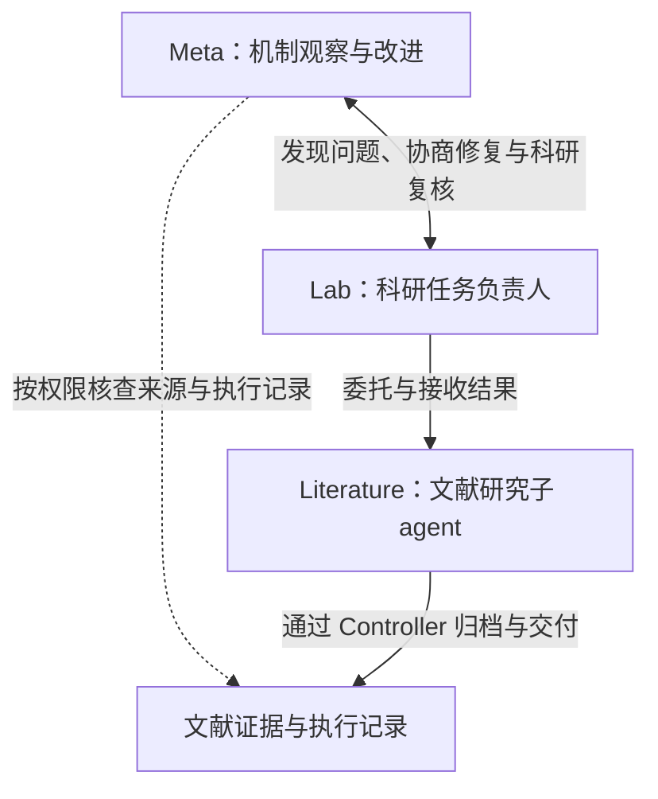
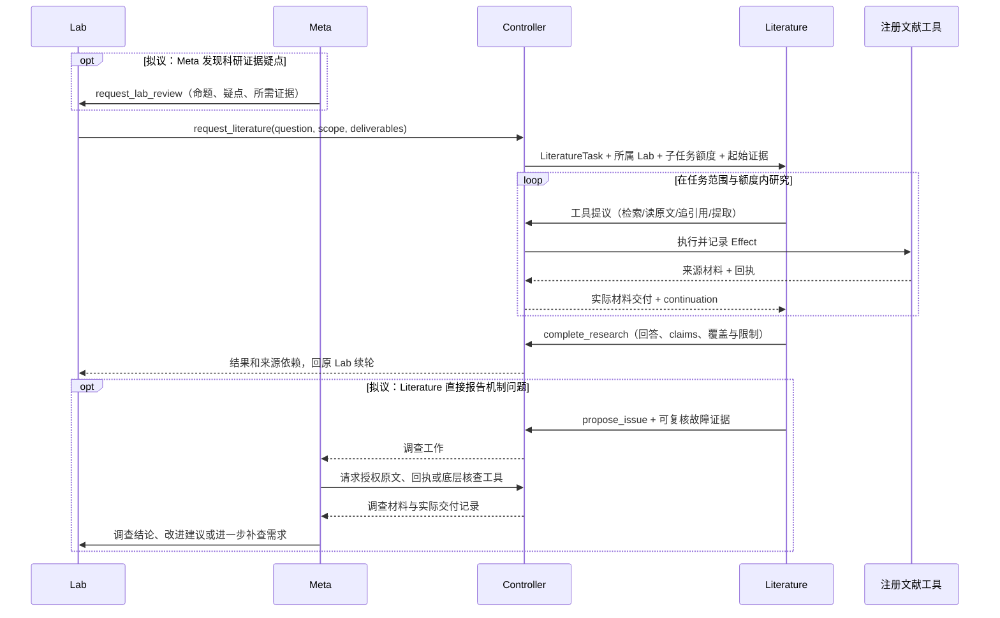

# Literature：Lab 的文献研究子 agent

状态：运行时与首批工具桥已实现，2026-11-15；本文同时保留明确标注的后续设计。当前闭环是 `Lab.request_literature → 独立 Literature 会话 → 已注册工具 → Literature 续轮 → 阶段/最终结果与原文 → 原 Lab`，包含子任务额度、版本检查、来源交付与恢复。当前定义 13 个文献能力及 15 个 provider 条目（9 个主线、6 个可选）；实际工具目录只注册启用 provider 能执行的操作；条目可能需要凭证、模型或宿主部署，不表示全部已真实联网验收。

可运行命令、精确 payload、provider 条件及实测边界见[文献工具使用说明](literature-tools.md)。本文第 6 节区分已实现与拟议命令。更丰富的 EvidenceBundle、任务修订/取消、Meta→Lab 补查需求对象和科学支持关系属于目标设计，不能作为当前 API 字段提交。

## 1. 角色定位

Literature 是 Lab 管理的文献研究子 agent。Lab 决定研究目标、优先级、资源分配和结果如何用于科研任务；Literature 在委托范围与额度内自主拆题、检索、筛选、阅读全文、追踪引用、提取证据、综合并补查，向所属 Lab 交付可复核的研究结果。

组织归属与运行时实现分开：Literature 有自己的会话、工作记忆和多步研究循环，执行与恢复沿用通用 Controller；独立会话不赋予它与 Lab、Meta 同级的科研管理职责。它的目标与任务生命周期归 Lab 管理，具体搜读策略由它自行决定。



| 角色 | 负责的判断与产物 | 协作边界 |
| --- | --- | --- |
| **Lab** | 科学问题、实验与分析方案、研究进展、证据对当前任务的适用性及科研取舍 | 当前创建 Literature 子任务、分配任务内额度并接收结果，决定如何使用证据；任务调整、取消及显式验收命令待实现。改变冻结科学协议仍走现有版本与试验流程 |
| **Literature** | 检索与阅读计划、论文筛选、原文证据、跨论文比较、适用条件、冲突与未知项 | 向所属 Lab 负责，在委托内自主选择下一项文献工作并提出建议；实验执行和最终科学决策由 Lab 负责 |
| **Meta** | 主动发现遗漏前提、方法冲突和机制异常，调查与改进系统能力、工具和工作流程 | 向 Lab 提出科研补查或复核需求；按权限直接核查原文与执行记录、使用共享底层工具调查机制问题；不接管 Lab 的子任务 |
| **Controller** | 权限、调度、调用执行、来源归档、预算、版本、回执、结果交付与恢复 | 校验角色提议并执行注册能力；执行与出处校验不等于认证科学判断成立 |

普通文献研究由 Lab 直接发起，无须先创建 Meta issue。组织设计要求 Meta 对当前科研任务的文献补查需求送给 Lab，由 Lab 转化为 Literature 子任务；专用需求命令尚未实现。Meta 不成为同一个子 agent 的第二个任务管理者。Literature 获得任务级授权后，可以自行换查询、换已授权来源、读下一页、追下一条引用；任务范围内的这些选择无需 Lab 逐次审批。

### Lab 自主决定是否委托（已实现）

每次 Lab 调用都收到通用的文献决策策略：先识别会影响当前决定的外部知识缺口，再检查本轮原文是否已经足够。方法适用性、跨条件外推、竞争解释或尚未交付的来源内容可以触发委托；本地观测、明确公式、执行记录和已有充分原文通常直接处理。科学主题本身不构成调用理由，任务也不必出现“查文献”等字样。

启用文献能力时，Runtime 向 Lab 提供 `task.literature_context`：已注册能力、运行剩余额度，以及同一 owner/branch 的子任务、状态和结果指针。最多展示 16 个任务，活跃任务优先，省略数量明确标出。它用于避免重复研究和预留回传预算，不代表论文原文已经交付。任务描述与结果 ID 不获得引用权威。

Lab 在现有 `working_memory_delta.rationale_summaries` 中记录一个简短的 `literature_decision`，值为 `delegate`、`use_delivered_evidence`、`local_work`、`await_existing`、`blocked` 或 `not_needed`，附行动理由、当前交付的证据 ID 和已有任务 ID。协议校验决策记录与实际命令、证据和任务身份一致；它不认证科学判断正确。真正的调用仍由模型选择 `request_literature`，没有关键词触发器、强制配额或验收脚本代写的委托。

实现入口为 [`roles.py`](../rsi_lab/roles.py) 的 `LAB_LITERATURE_POLICY` / `literature_decision_record`、[`literature_context.py`](../rsi_lab/literature_context.py) 和 Runtime 的 `_context`。没有启用文献能力的旧运行不要求新增决策记录。自主路由对照与持续优化验证见[验收报告](literature-autonomy-validation.md)。

Lab 验收的是交付是否满足任务用途。来源材料、反证和未解决问题保留在不可变记录中；未来的调整、拒绝验收或取消命令也必须保留这些材料与 Meta 已获准的审计访问。

职责以 literature tool calling 为中心。论文中的方法可以成为比较和建议的对象；复现论文代码、搭建实验环境、执行实验和通用科研编排属于其他能力。

## 2. 三个交互对象：当前子集与扩展目标

目标主交互为 `LiteratureTask → ResearchUpdate* → EvidenceBundle`。当前已分别保存任务登记、工具来源事实、阶段/最终解释性结果；并未实现本节所有扩展字段或一个独立的完整 EvidenceBundle 服务。下表描述目标语义，当前可提交字段以第 6 节及运行时 schema 为准。

### 2.1 LiteratureTask：委托一个问题

Lab 已有 `request_literature` 命令。Lab 提交研究规格，Controller 验证后建立子任务并绑定父子关系及执行上下文。未来可将 Meta 的科研补查需求保存为委托起因，但不改变子任务的管理归属与返回目标。

| 部分 | 字段与语义 |
| --- | --- |
| 问题与用途 | `question`、`intended_use`：要回答什么，结果将用于哪个科研判断或机制调查 |
| 研究方式 | `purpose: research / verify`：开放研究或针对明确问题核查；都是 Literature 的工作方式 |
| 范围 | `scope`：领域、对象、方法、时间范围、纳入与排除条件；允许开放检索，不要求预先知道论文 ID |
| 起点 | `seed_papers`、`prior_bundle_refs`、`existing_evidence_refs`，均可为空 |
| 交付要求 | `deliverables`：如方法比较、参数依据、证据表、反证清单；`evidence_requirements`：哪些问题需要正文、表格或原始研究 |
| 停止要求 | `stop_conditions`：所需问题覆盖、关键缺口处理、阶段性交付条件 |
| Controller 绑定 | `task_id/revision`、`run/branch`、`parent_agent_id`（所属 Lab）、`parent_task_id`、`parent_work_id`、Literature 实例、返回 Lab 的目标、可选 `originating_issue_id`、获准能力与版本、资源额度、deadline |

当前 Lab 在委托时指定子任务模型/工具调用额度，每次实际 Effect 仍经过 run 预算预约；可观察用量同时受子额度与 run 额度约束。追加资源与任务修订尚无命令；未来修订文献范围也不能改写上层冻结的科学 TaskPlan。父 Lab 身份与返回目标已由 Controller 从真实委托绑定，不能由模型任意填写或转移。

例如，Lab 可以委托：“比较方法 A 与 B 对本任务数据条件的适用性；找支持和反对采用 A 的原始研究；输出比较表及关键原文。”Literature 决定具体查询、论文顺序和补查路径。

### 2.2 ResearchUpdate：有用的阶段性结果

目标对象包含 `task_id/revision`、新增判断与证据引用、已覆盖/未覆盖问题、当前阻塞、下一步、是否建议提前结束或调整任务。当前 `publish_research_update` 使用与最终结果相同的 `answer/coverage_status/stop_reason/limitations/claims` payload，任务身份与版本位于命令外层。

当前由 Literature 自主决定何时发布更新；建议只在结果会影响决策、出现任务级阻塞或到达检查点时通知所属 Lab。工具结果先返回 Literature；显式更新才唤醒父 Lab，并安排 Literature 续轮。复杂检查点、依赖与任务变更协商仍待扩展。

### 2.3 EvidenceBundle：回答与可复核证据的目标格式

| 内容 | 必须保留什么 |
| --- | --- |
| 任务结果 | 对问题的回答、请求版本、完成程度、停止原因、未解决问题及继续研究的具体价值 |
| 论文与文档清单 | DOI/PMID/arXiv 等标识及关联依据，具体版本、来源、获取时间、原件 hash、访问状态、解析产物版本 |
| 来源关联 | `source_group`、`independence_status: assessed_independent / shared_origin / unknown` 及判断依据；同一研究的多个版本、同一数据集/队列的重复分析和综述转引不能自动算作独立支持 |
| 原文材料 | 原文片段、上下文入口、正文/表格/图像类型、页/章节/段落/单元格/图区域等定位、对应 Effect 与交付回执 |
| 逐项判断 | `source_statement / extracted_observation / synthesis / recommendation`，适用条件、支持与反证片段、限制、判断作者及复核状态 |
| 检索与筛选 | 来源、查询、过滤、分页、纳入/排除理由、去重与版本关联、已追/未追的引用分支 |
| 覆盖与缺口 | 摘要可用、正文可用、实际阅读范围、未读材料、解析失败、互相冲突的研究、无法取得的证据 |

当前交付回答、claim 的证据 ID、限制及其来源依赖；原文依赖通过 packet 实际交付，完整原件与轨迹保存在来源存储。表中的独立性判断、结构化支持/反证类型、图区域定位及完整筛选轨迹尚未成为专用对象契约，不能据此宣称自动科学支持检查已经完成。

Bundle 是交付与审计格式，不替代目标设计中的 Scientific Memory。后续可映射到 Question、Evidence、Claim、Investigation、MethodExperience、Decision：Literature 提议来源和文献判断，Lab 提议科研决定，由 Controller 按对象契约校验登记。科研用途的 LiteratureTask 可关联 ScientificInvestigation；Meta 的机制调查仍归 Issue 与对应调查工作，文献任务为其提供证据，不自动变成 ScientificInvestigation。各对象仍需原有的支持检查。

## 3. 工具接口

工具层以稳定操作契约隔离具体 provider。当前复用注册 `Adapter` 的 `prepare / reservations / execute / publication` 路径，由 Literature 通过 `request_diagnostic` 请求能力；子任务内的研究循环由 Literature 自主维护。底层文献工具是可按角色授权的共享能力，不因归入 Literature 工具包就成为其独占能力。

### 3.1 基础能力

| 已注册 capability ID | 当前主要输入 | 主要输出与行为 |
| --- | --- | --- |
| `literature.search_papers` | `query`，可选 `provider/filters/cursor/limit` | 候选元数据、摘要、来源和下一页；不表示已读全文 |
| `literature.get_paper` | `paper_ref`，可选 `provider` | provider 支持的论文标识、元数据和全文入口 |
| `literature.acquire_fulltext` | `paper_ref` 或宿主登记的 `source_id`，可选 `provider` | 原件、文档句柄、hash 与解析状态；缺全文或访问能力时返回明确状态 |
| `literature.read_document` | `document_id`，可选 `document_version/locator/cursor/max_bytes` | 规范原文片段、可用定位、实际范围和下一页；不保证任意图表结构定位 |
| `literature.find_passages` | `document_ids/query`，可选 `limit/max_bytes` | 本地词项检索片段；不是全语义检索或全文检查证明 |
| `literature.get_citations` | `paper_ref/direction`，可选 `provider/cursor/limit` | `references/citing` 两个方向的文献与分页；不是命题支持关系 |

`acquire_fulltext` 表示取得和准备原件；`read_document` 表示把特定内容实际交付给模型。前者成功不代表后者完成。已有本地文献也经来源登记后进入相同读取接口。

### 3.2 可选增强能力

| 已注册能力 | 当前实现与边界 |
| --- | --- |
| `literature.extract_evidence` | 对登记文档调用显式配置的 SDK 或推理部署；返回解释性抽取与来源关联，无法验证的文本位置标为未定位 |
| `literature.build_reading_package` | 本地文本导航，或调用 Poppler、已配置 GROBID、Paper2Skill；取得派生文档后仍需显式读取；文本提取不等于图表阅读 |
| `literature.render_document_page` | 仅 Poppler；按原始或派生文档 ID、页码渲染有界 PNG，绑定原件与图像 hash，作为图像材料进入模型 packet；实际交付与理解结论分别记录 |
| `literature.run_review` | 托管任务生命周期或已部署研究程序；保留输出、handle、来源关联与内部调用可见性；不保证所有内部费用可控 |
| `literature.list_providers` | 返回 15 个 provider 的主线/可选分组、本地配置条件与启用状态，不进行联网验收 |
| `literature.provider_tools` | 查看 Asta/Scite 允许的 MCP 工具 schema |
| `literature.call_provider_tool` | 按宿主允许列表调用 MCP 文献工具 |

Starling 的宿主部署桥、Paper2Agent/Paper2Skill 的 prepare/extract 阅读管线已经接入不同增强能力，二者成熟度不同。具体配置和实测范围见[provider 表](literature-tools.md#3-provider接入与当前验证范围)。Paper2Skill 此次验证是两页 PDF 阅读材料构建，不包含 Paper2MCP 生成代码工具或对科学方法的认证。

高层研究服务产生的答案作为外部综合判断保存。若服务只提供摘要或引用链接，不能把它的答案发布为 RSI-Lab 已读原文；必要时回到基础工具获取来源。无法观测服务内部每次调用时，明确记录可见粒度，不虚构完整执行轨迹。

### 3.3 公共结果契约

每个 adapter 返回：

```text
ToolResult
  status: ok | partial | unavailable | failed
  data: 操作对应的结构化数据
  provenance: 已观察到的 provider、来源、处理方式等；字段因操作而异
  coverage: 可用内容、实际返回范围及缺口；不保证所有 provider 有同样字段
  continuation: provider 分页 cursor、任务 handle 或完成状态
  errors: code, detail, retryability
```

Controller 另保存真实 `effect_id`、请求指纹、回执及其 hash、可观察成本和交付记录。模型不用手工生成这些执行身份。操作 schema、数据类型、分页语义和能力边界由注册 manifest 明确；没有的信息返回未知或不支持，不能填成空集合来暗示不存在。外部调用后执行结果不确定时可附 `execution_unknown=true`，对应 Effect 保留为 unknown。

分页完成只表示取完本次 provider 查询可返回的结果，不表示覆盖了全部文献。原生可观察 HTTP、下载和解析调用按实际情况结算；SDK 和高层服务的内部模型、embedding 或检索调用可能不可观测，以 `cost_visibility` 明示，不能虚报为零或声称全部受 run 硬额度控制。未知提交不会自动盲重试；重放已成功的发布材料不再次调用 provider。

## 4. 全文阅读与引用追踪

### 4.1 阅读链路

`发现论文 → 解析身份 → 取得原件 → 建立章节/图表索引 → 定位相关内容 → 阅读及补读上下文 → 提取/核查 → 引用交付`

分别记录四种覆盖：provider 声称有什么、实际取得什么、解析得到什么、模型收到什么。正文、附件、图像和表格各自记录状态。例如取得 PDF 但只解析出摘要时，阅读范围仍是摘要。

当前采用绑定文档及解析版本的规范文本 offset、来源 hash 和分页 cursor，并保存解析器能够提供的定位。Poppler 可保留文本页码并将页面图像绑定到原始 PDF；完整 PDF 区域、XML 元素、表格单元格映射仍不是当前统一保证。PDF 文本层解析也不是 OCR 验收。OCR 和模型抽取都是派生产物，重要数值、单位或表格关系需要可回查原件。

读过全文由章节/范围覆盖记录支持，不能用一个下载成功标志替代。PDF skill 的阅读流程映射为：取得原件、Poppler 文本提取、定位相关页、单页渲染、模型在当前轮次收到图像后视觉复核。PNG 通过受控能力和 packet 交付，保留原件及图像 hash；没有实际交付的页面不能标为模型已读。模型不能传本地路径或命令，接入不开放全局 shell。图像交付也不自动证明表格结构或科学结论已正确理解；具体实测范围见[接通状态](literature-connectivity.md)。

### 4.2 两类关系分别保存

1. **论文引用关系**：论文 A 的参考文献包含 B，或论文 C 引用了 A。记录方向、provider、数据时间、可用的正文引用位置和版本关系。Literature 自主沿图扩展，但受查询深度、论文数量、时间和费用上限约束。
2. **判断的证据关系**：判断 X 与某篇论文的具体片段是支持、挑战、限定条件或背景关系。记录原文定位、解释、判断者及复核状态。

论文引用了另一篇论文，不等于支持它。provider 的支持/反驳标签作为来源提供的分类保存；Literature 核查后的解释另存。引用数可用于探索排序，不能直接充当证据质量分数。

### 4.3 跨轮、跨角色的证据交付

保留当前“只有本轮实际交付的来源可用于本轮原文引用”的边界。工具续轮将新工具事实标为必要交付；旧来源仍在目录/请求集合中，可经现有 paged/narrowed 策略显式延后。需要引用旧原文时，必须确保它在本轮实际交付，必要时重新读取。历史工作记忆帮助找回片段，本身不充当来源。

Lab 接收子任务结果时，Controller 同时要求交付该批判断依赖的原文。Meta 核查材料时通过自己的授权 packet 获得对应原文与回执，不继承 Lab 的阅读记录。当前必要来源超出 packet 容量会阻塞，不能静默删除；自动拆分完整 EvidenceBundle 仍是扩展目标。一次交付认证的是对应片段，不是整份文档。

出处验证与科学支持判断分开：hash/offset 能证明片段来自哪个版本，不能自动证明它支持某个结论。模型抽取与综合保留推断身份，不因进入 ledger 就升级为已验证科学事实。

## 5. 与 Lab、Meta 的协作流程

下图实线执行路径已实现；标明“拟议”的两类跨角色请求尚未加入命令 allowlist。



当前 Literature 将论文分歧、解析错位、证据不足、工具失败或潜在方法问题写入阶段/最终结果，交给 Lab。Lab 已可使用自身的 `propose_issue`；Literature 直接向 Meta 提议调查尚未实现。未来问题报告也不转移子任务归属。单篇全文不可取得应先尝试任务内其他可用来源并报告缺口。

Meta 可在自己的授权和预算内直接读取既有原文、日志、回执，或调用共享检索/读取工具做机制核查，不需要 Lab 批准或先给出摘要。目标流程要求科研补查经 Lab 分派并保存接受、排期或拒绝记录；这套专用需求及回传对象尚未实现，不能声称已有自动闭环。

Meta 保留既有观察与调查机制。当前 Literature 工具结果直接续接同一子任务，不将每个阅读页自动变成 Meta 观察调用；研究任务聚合观察、低频开放审查和新的需求路由还需各自的调度策略。

Meta 发起核查应说明要核查的命题、可能的问题以及能区分解释的证据。需要先看原文的复核时，先交付原始材料并保留初始判断，再交付 Literature/Lab 的解释作对照。Lab 可以为独立检索路径启动新的 Literature 子实例，并记录明确的起始上下文；这不代表它在组织上独立于 Lab。Meta 的机制审计由自身执行；同一持久会话的再次检查只能标为复查，不能仅凭角色或调用次数宣称独立。

## 6. 当前命令、状态与持久记忆

### 6.1 命令边界

| 发起方 | 命令 | 状态 | Controller 行为或目标 |
| --- | --- | --- | --- |
| Lab | `request_literature` | **已实现** | 创建子任务及 Literature Work，固定父 Lab、branch、子实例、能力版本、额度与返回目标；可不关联 issue |
| Literature | `request_diagnostic` | **已实现** | 仅调用本任务固定版本的 `literature.*` 能力；已知工具结果回同一子任务 |
| Literature | `publish_research_update` / `complete_research` | **已实现** | 校验本轮实际交付的证据引用，发布带来源依赖的解释性结果；更新可继续，完成则结束本次委托 |
| 所属 Lab | `revise_literature_task` / `cancel_literature_task` | **拟议** | 需验证父子关系、任务 revision，保留已有材料及未结算义务 |
| Meta | `request_lab_review` | **拟议** | 保存科研补查需求并交 Lab 处置，不直接管理 Literature |
| Literature | `request_research_change` | **拟议** | 将澄清、范围或额度需求送回 Lab，保存明确等待条件 |
| Literature | `propose_issue` | **拟议** | 该动作目前只在 Lab/Meta 既有模式内可用，尚未授权给 Literature |

当前委托 payload 恰好包含 `question/intended_use/scope/deliverables/capability_ids/max_model_calls/max_tool_calls`。两种结果动作恰好包含 `answer/coverage_status/stop_reason/limitations/claims`；claim 字段为 `statement/evidence_ids/limitations`。`purpose/seed_papers/deadline/evidence_requirements` 等第 2 节目标字段不能直接加入当前闭合 schema。

Literature 命令外层绑定 `task_id/task_revision`，沿用 session head、工作记忆 revision 和 Effect 提交检查。引用必须在本轮实际交付；claim 引用还须包含在命令的 `evidence_ids` 中。工具 continuation 回同一 Literature 子任务，结果 continuation 回所属 Lab，身份均由真实委托推导。通用 handoff 不能创建绕过 Lab 委托的 Literature 任务。

将 Meta 需求关联到子任务并自动通知处理进展仍是后续目标；即使未来直接交付调查材料，也不授予 Meta 修改子任务或续接 Literature 会话的权限。

### 6.2 状态与停止

当前任务是 `registration(kind="literature_task")`，状态为 `active/completed`。执行排队、等待、失败或未知分别由 Work、Effect、session、proposal 状态表达；不能把它们当作已存在的任务 `cancelled/failed` 状态。未来若扩展 `queued/running/waiting/cancelled`，须定义真实迁移和未结算义务。

结果另有 `coverage_status: sufficient_for_requested_use / partial / unresolved` 与明确停止原因，如问题已回答、矛盾已定位、无法取得必要材料、额度/时间耗尽。`completed` 只表示本次委托已交付，不表示科学问题得到证明。没有搜到结果必须附检索范围，不能改写成“不存在相关研究”。

子任务限制 `max_model_calls>=2`、`max_tool_calls>=1`，步数为二者之和；每个 Effect 同时经过原有 run 预约。子额度按已记账实际用量和尚未释放的预约计算。没有足够子模型额度读取新工具结果、或子工具额度无法容纳下一次调用时，闭环保留已有证据并向 Lab 报告未解决；run 级准入拒绝仍按原控制器阻塞规则处理。追加额度和截止时间命令尚未实现。

Lab 等待子任务时，Controller 可以继续推进 Literature，不需要父会话保持一个活动调用。已派发 Effect 继续按真实终态登记与结算；未知执行不能通过重启、换会话或重发来消除。未来父任务取消/修订的传播规则必须显式覆盖子工作与远程任务，不能由一次状态改写代替。

### 6.3 记忆与增量研究

当前每次委托创建一个新的 Literature 实例及其独立持久会话，同一实例的 turn 串行。Literature 是其私有工作记忆的 owner；父 Lab 管理任务，不因此获得任意读写子会话的接口。私有记忆可记录查询计划、已尝试路径、待读队列、暂定解释和下一步；它是未验证工作状态，不是原文读取凭证或共享科学结论。

同一授权范围内可复用已归档文档并重新交付所需片段。基于旧 bundle 的增量任务、版本/更正/撤稿触发复核及完整独立性评估仍是扩展目标；当前没有实时监测承诺。

来源存储保留版本和 hash；新结果不覆盖旧证据。恢复依据 ledger 与原始回执；已完成但未发布的调用补发布，执行状态未知的调用保留对账责任。默认 packet 上限为 128 KiB；持久模型会话需另设符合宿主模型容量的 `max_effective_context_bytes`，否则其默认继承 packet 上限会较快阻塞。增加容量不能免除真实预算与来源交付检查。

## 7. 与当前代码的接入点

实现已覆盖角色、会话、调度、工具、预算和证据路径；并非只增加一份角色 prompt。

| 位置 | 已实现职责 |
| --- | --- |
| [`roles.py`](../rsi_lab/roles.py)、[`packets.py`](../rsi_lab/packets.py) | Literature mode、闭合命令 schema、任务版本与实际交付引用检查、packet 容量 |
| [`agent_state.py`](../rsi_lab/agent_state.py) | 独立 Literature owner/session/记忆；拒绝通过通用 handoff 绕过受控委托 |
| [`controller.py`](../rsi_lab/controller.py)、[`runtime.py`](../rsi_lab/runtime.py) | 文献 Work/模型 Effect、父子身份、子额度与 run 预约、多步 driver、提交及恢复 |
| [`runtime.py`](../rsi_lab/runtime.py) 的路由与发布 | 无 issue 委托、工具结果回原子任务、阶段/最终结果及原文依赖回原 Lab |
| [`adapters.py`](../rsi_lab/adapters.py)、[`rsi_literature/`](../rsi_literature/) | 保留内核 Effect 类型；13 个版本化操作、15 个 provider 条目（9 个主线、6 个可选）、本地文档存储、可选 SDK/部署桥 |
| publication 与证据 packet | ToolResult 来源陈述、实际阅读片段、解释性结果及 `summary_of` 依赖；不是完整 Scientific Memory 服务 |
| [`__main__.py`](../rsi_lab/__main__.py) | 显式 `--literature-config` 注册、能力状态查看、`literature-step` 及统一 driver |

Literature 需要完整的子 agent 会话与调度接入；通用调度器能执行其 turn，不代表它成为第三个顶层负责人。它的任务状态、研究决策和交付责任不能由一个黑盒 diagnostic 调用替代；它可以在 Lab 的委托范围内自主委托有限子问题给高层研究服务，记录服务的可见范围，并决定采纳、补查或拒绝其结果。工具 adapter 承担能力执行，Literature 保持研究过程的责任与可恢复状态。

## 8. 已验证范围与后续验收

当前已有原生元数据/引用接口、本地与可取得的开放原件、分段读取、词项检索，以及可选抽取/阅读包/研究服务桥。真实检查覆盖 Europe PMC 全文 JATS 获取和连续分页、引用双向分页，PubMed/OpenAlex 元数据，Asta `tools/list/get_paper`，Paper2Skill 两页 PDF 管线。Semantic Scholar 的显式标题匹配曾成功，但普通接口及 Runtime 复测仍限流。MinerU 已移除；默认 PDF 基础后端为 Poppler，文本、图像及交付验证分别记录。当前启用与关闭策略见 [接通状态](literature-connectivity.md)。其余服务与项目的配置、mock/进程契约测试边界见[使用说明](literature-tools.md)。

已覆盖的回归行为：

1. Lab 无 issue 委托、独立 Literature 会话、多步工具续轮、原文与结果返回同一命名 Lab。
2. 本地原件获取、分段读取、版本/来源绑定和本轮证据校验；12 能力 schema 与 packet 容量检查。
3. 未配置服务返回可发布的明确状态；非法输入在 Effect 前拒绝；托管 handle 与引用方向正确路由。
4. 完成后未发布的工具恢复时不重复执行或收费，未知提交不盲重发，恢复保留原接收方。
5. 子任务能力版本、调用额度及 run 预约约束，旧证据显式延后仍不能当作本轮已读来源。

后续需要单独实现及验收：Meta→Lab 科研补查需求闭环、任务修订/取消/追加额度、父任务取消传播、结构化独立性及支持/反证关系、完整图表多模态定位、自动 Bundle 分批交付、撤稿/更正复核。供应商真实付费模型、所有远程权限与高层服务内部成本控制也没有因契约测试通过而得到验收。

相关现状文档：[文献工具使用说明](literature-tools.md)、[通用内核与能力包](rsi-lab-core.md)、[持久会话与工作记忆](persistent-agents.md)。完整目标系统见[系统设计](system-design.html)；目标条目不扩大当前 schema 或角色权限。
