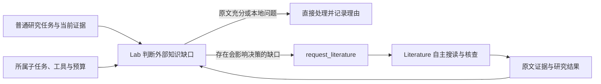

# Lab 自主调用 Literature：机制与真实验证

日期：2026-11-15。模型统一为 `gpt-6.1-sol`，推理强度 `high`。

实测源码保存在提交 `ae3dbea`，基于当时本地核心 `16e607d`。发布 PR 时另行整合远端 `main` 的 `7bc9747`，保留其可选 Scientific Memory 和 Meta→Lab 反馈；整合后使用离线回归检查，没有重跑真实 200 次评估。下面的原始实测结果仍归属于原冻结源码。

`runs/` 中的账本、模型原始对话、论文与图像均为本地运行产物，不随 PR 发布。文中的运行路径供持有原始产物的使用者定位；公开仓库包含实验设计、结果概要和复现脚本。

## 实现范围

自主判断发生在普通 Lab 模型调用中。`roles.py` 中的通用策略要求 Lab 判断外部知识缺口是否影响当前科学决策，检查已交付原文是否充分，并参考 Runtime 提供的任务归属、已有研究与剩余额度。需要补查时由 Lab 自行构造 `request_literature`；已有充分证据、本地计算或执行事实则直接处理。没有关键词触发器或最低文献调用次数。

每轮 Lab 返回简短的 `literature_decision` 行动记录，协议验证其与命令、实际交付证据和所属任务一致。验证结构一致不等于验证科学判断正确。现有 Literature 子任务仍使用独立会话、固定能力版本、任务内预算和原文交付检查，最终返回原 Lab。详见[角色设计](literature-agent-design.md#lab-自主决定是否委托已实现)。



## 冻结的验证设计

两部分分别计数，模型输入中不放测试预期或评分标签。

1. **正反例路由检查**：10 组配对问题，共 20 次独立 Lab 初始决策。每对任务目标与规划数值相同，只改变关键原文是否提供；每次使用新会话。任务没有要求“查文献”或调用 Literature。数值是明确标注的规划示例，不冒充真实实验观测。两个正例在模型运行前选定，执行完整的子任务与父 Lab 回传；其余 18 例只测初始路由，产生的委托意图不执行，不记为已完成研究。
2. **持续分子优化**：沿用“新 200 轮”的既有含义，以原始 CSV 的前 100 个候选和分数起步，获得 200 个此前未测、有效、规范化身份唯一的新候选的真实评分，最终为 300 个观测。不是 200 次模型调用。候选只能由真实 Lab 命令提出；评分器内部实现不交付模型。不续接旧暂停运行。

主任务只要求优化不透明数值目标并如实解释策略和适用范围，不要求检索或规定委托频率。因此持续任务中零次 Literature 调用可以是合理结果；正负路由能力由单独对照检查衡量。

正反例覆盖 QED 解释范围、SA score 方向、GNINA CNNscore、AD4/Vina 分数混用、质子化、随机重复、MoleculeNet 划分、MOSES 新颖性分母、GuacaMol 指标覆盖与 smina 自定义评分方向。引用使用短原文并保留来源定位；对照预期独立保存在宿主私有文件。它们是 10 组相关的人工构造情境，不能据此声称通用路由准确率。

## 运行产物与复现

正反例冻结目录为 `runs/literature-autonomy-probes-20261115/`，包含 `manifest.json`、`public-cases.json`、`private/oracles.json`、各 case 的真实调用账本和结果。模型请求、原文交付、命令应用与子任务回传均从真实 receipt 复核，保留首次决定和错误，不替换失败样本。

```sh
PYTHONPATH=. .venv/bin/python scripts/validate_literature_autonomy.py \
  --root runs/literature-autonomy-probes-new-run \
  --literature-config examples/literature-tools.json
```

以上命令创建新的验证目录。原有运行只能使用对应的冻结源码和配置续跑；整合后的 PR 源码不能通过旧运行的源码指纹检查。

持续评估使用安装 RDKit/GuacaMol 的科学 Python 环境运行 `scripts/run_literature_autonomy_campaign.py`。完整源 CSV、初始观测、配置、代码与适配器指纹被冻结；续跑须匹配冻结身份，未知执行不得自动重发。每轮 Lab 获得全部已有观测和剩余额度；会话重建保留同一 owner、工作记忆、原始证据与累计预算。原冻结验收使用当时 Runtime 与最小 PABLO 领域适配器，未启用高级 Scientific Memory 或 research host；当前 PR 已保留上游的这些实现，其组合行为另以离线回归检查。

实测科学环境包含 Python 3.11.14、RDKit 2024.9.6、GuacaMol 0.5.5。设置 `SCIENCE_PYTHON` 指向自己安装这些依赖的虚拟环境解释器。初始化不调用模型，正式执行与只读验收分开：

```sh
PYTHONPATH=. "$SCIENCE_PYTHON" scripts/run_literature_autonomy_campaign.py \
  --root runs/my-new-campaign --initialize-only
PYTHONPATH=. "$SCIENCE_PYTHON" scripts/run_literature_autonomy_campaign.py \
  --root runs/my-new-campaign --resume
PYTHONPATH=. "$SCIENCE_PYTHON" scripts/run_literature_autonomy_campaign.py \
  --root runs/my-new-campaign --resume --audit-only
PYTHONPATH=. "$SCIENCE_PYTHON" scripts/audit_literature_autonomy_campaign.py \
  --root runs/my-new-campaign
```

最后一项独立从 CSV、真实调用目录、原生会话记录、评分日志及账本重建验证，不调用评分器或模型，也不复用 runner 的 `audit` 函数。

## 结果

### 正反例（已完成）

| 预先设定的情境 | 样本数 | 自主委托 Literature | 直接处理 | 首次路由符合预期 |
|---|---:|---:|---:|---:|
| 缺少决定所需的原文依据 | 10 | 10 | 0 | 10/10 |
| 已交付充分的关键原文 | 10 | 0 | 10 | 10/10 |

20 个首次决定均有真实模型 receipt、完整原文输入和已应用命令；没有绕过子 agent 直接调用文献 diagnostic。20 次初始调用加上两个预选案例各 4 次 Literature 调用、1 次父 Lab 回传，合计 30 次真实模型调用。

| 预选完整链 | 真实文献操作 | 父 Lab 结果 | 链路验收 |
|---|---|---|---|
| MOSES 新颖性定义 | 获取全文、读取文档、查找段落 | 正确使用独特有效分子为分母，得到 4/6；区分训练集新颖性与其他新颖性主张 | 通过 |
| MoleculeNet 划分 | 获取全文、读取文档、查找段落 | 选择 scaffold split 匹配骨架分组要求；没有宣称已证明前瞻预测性能 | 通过 |

两条链均核对真实工具执行、原文实际交付并被子 agent 引用、完成研究、同一父 Lab 收到来源与结果并应用最终处置。每条链有 3 个文献操作、4 个计费工具单位（其中取得全文包含网络请求）。其余 8 个正例仅证明正确发起委托，未执行研究。

两个完整链的 token `overrun` 标记为真，含义是某次实际 token 超过该次调用的软预估；各自总量 454,437 / 442,109，均低于每例 4,000,000 的软总限额。模型和工具硬额度均未超过，预留已结清。标记按控制器定义保留，未改写为“无异常”。

本机产物：`runs/literature-autonomy-probes-20261115/` 下的 `summary.json`、`results.json` 和 `independent-audit.md`。语义复核由案例作者检查原始响应和证据，并非盲评或外部专家验证。

### 持续 200 次新评估

全新目录为 `runs/literature-autonomy-campaign-200-20261115/`。评分与 Lab 收尾已完成。首次自动运行未完全收尾：最后一个 Meta 调查调用了仅允许 Lab 使用的评分器，调用被拒绝且没有产生新评分，失败结果未自动回传，留下一个 open issue 和 waiting。不能据此报告完全自主的全流程通过。

| 项目 | 实际结果 |
|---|---|
| 初始观测 | 原始 CSV 前 100 行，未经重采样或替换 |
| 新增真实评分 | 200 个，有效且规范化身份唯一 |
| 总观测与唯一候选 | 300 / 300 |
| 评分批次 | 13 批：9×20、10、5、3、2；末段批次由 Lab 自主缩小 |
| 最佳初始分数 | 0.4909902530309828 |
| 最佳最终分数 | 0.5874799940107168（新评估 175、181 并列） |
| Literature 委托 | 0 |
| Lab 最终处置 | 收到完整 300 个观测与剩余 0 额度后，实际应用 `no_action` 最终总结 |

本次路径中，Lab 根据局部黑盒反馈提出和修正候选，把组合收益、结构偏好和替换效果保留为可被后续观测否证的假设。最终明确没有证明全局最优、目标机理、普遍构效规律、可合成性、稳定性或真实药效。因此零委托与本次实际使用的论据相符；它不说明其他优化任务不需要文献，也不说明此机制导致了分数提升。

本机 `runs/literature-autonomy-campaign-200-20261115/semantic-review.md` 覆盖 14 个真实响应：13 次 `local_work` 和最终一次 `use_delivered_evidence`。这是基于实际轨迹的事后审查，不计为额外 14 个预注册正反例，也不是外部科学验证。复核未读取隐藏目标或重新评分。

固定轨迹 SHA256：`88bc8a2d8578409a7ee89d2394cec8b343380fece829b4488e6476c3fbd80e57`。

首次自动运行共 62 次真实模型调用（14 Lab、48 Meta）、21 个工具计费单位，token 计数为 5,422,689。独立审计确认所有评分日志、模型输入、原生会话身份与预算对账一致；原生 transcript 和 stdout journal 中实际额外工具项均为 0。模型没有绕过受控接口读取隐藏目标或执行工具。token `overrun` 标记来自单次软预估被超出，总量仍低于 30,000,000 的软总限额，模型和工具硬额度未超过。

### 收尾发现及恢复

1. 现有 Runtime 对非 Literature 的 adapter 原始事实统一触发 Meta discovery，Meta 自己的 `pablo.lookup` 也会产生新审查，增加了收尾成本。这次保留真实队列继续执行，没有删掉审查工作。
2. 最后一个 Meta 请求 `pablo.evaluate`，被评分器的 Lab 权限校验明确拒绝：`effect_4370f8ae7f89943dcf1e9ccc` 为 `failed_definite`，`scored_candidates=0`。权限边界生效，新增评分仍为 200；但普通 Meta diagnostic 的失败没有通知原 dependency，留下未决等待。
3. runner 的初始验收未检查 open issue / active wait，因此错误地给出了 `workflow_passed=true`。独立验收增加了这两项，并明确得出 `workflow_passed=false`；初始证据分别保存在本机运行目录的 `initial-driver-audit.json` 与 `independent-initial-audit.json`，不覆盖或改写。

随后执行了一次明确记录的宿主恢复：[`recover_campaign_tool_failure.py`](../scripts/recover_campaign_tool_failure.py)核验并补交原始失败回执和已有最终观测，原子更新原 issue 的证据及 dependency，再由正常 `tick` 唤醒同一 Meta。事件 797–799、登记 `host_tool_failure_recovery_27bfcfa4fb95a22266b69589` 保留了该介入，未重试评分、重置预算、修改原回答或代写结论。

沿原冻结 runner 恢复后，仅新增一次真实 `gpt-6.1-sol / high` Meta 调用。Meta 自主将最后的问题关闭为 `closed_unresolved`：200 次名额已经用尽，拟议扩展比较缺少观测，拒绝回执不能充当科学证据。最终为 63 次模型调用（14 Lab、49 Meta）、21 个工具计费单位、5,525,601 tokens；评分与轨迹 hash 均未改变。7 个 Meta 问题为 3 个 `resolved`、4 个 `closed_unresolved`，这些是模型按证据范围作出的处置，不是外部科学认证。

**这次证明了 Lab 文献决策和 200 次实际评估，但首次完全自主收尾未通过。** 恢复脚本是显式宿主入口，普通 Meta diagnostic 的自动失败通知尚未修复；冻结 runner 的原始全局通过标志也不足以替代独立检查。应分别读取本机运行目录的 `independent-initial-audit.md` 与 `independent-audit.md`，不能用恢复后的状态覆盖首次结果。

### 离线检查

原冻结验收时，内核测试 282 项、文献工具测试 185 项通过；PABLO 领域适配器与新 runner 各 6 项契约测试通过；显式恢复入口的 4 项契约测试通过。离线检查不代替上述真实模型行为验证。

PR 整合 `main` 后重新检查：`tests/` 发现 685 项，683 项通过，2 项因可选 MolScrub/Meeko 环境缺失跳过；另外单独运行 `tests/literature/` 的 185 项和 `tests/pablo/` 的 16 项，全部通过。合计 884 项通过、2 项跳过，没有失败。组合回归覆盖旧检索接口兼容、新版决策记录、Literature 权限隔离、Scientific Memory 图像发布/迁移及篡改拒绝；未重跑真实模型实验。
