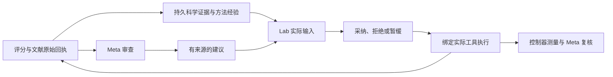

# PABLO 研究闭环入口

`scripts/run_pablo_research.py` 的 `pablo_research_v2` 架构在同一运行账本中启用三个可审计机制：Meta 建议的实际交付与结果复核、结构化 Scientific Memory、真实外部文献检索。示例模型配置为 `gpt-6.1-sol / medium`，续跑沿用父运行冻结的配置。历史实验保留原始结果和费用；新架构必须创建新运行目录。



## 建议如何进入下一次实验

Meta 的 `recommend_change` 必须引用当前完整交付的来源，指定已经注册的能力及版本、有限的修改建议、预期结果和可证伪条件。建议和原始来源一起进入 Lab 的实际输入包。

Lab 在正常响应的 `recommendation_responses` 中逐条采纳、拒绝或暂缓；采纳绑定同一次响应请求的 diagnostic Work，再绑定真实 Effect 和结果回执。控制器保存客观执行指标，调度一次带完整结果的 Meta 复核。重复回放不再执行工具、不重复计费、不反复创建复核。没有对照实验时，`causal_benefit` 始终保持未建立。

这是受控的搜索和研究行动闭环。建议不能注册任意代码、改写评分函数或自行认证能力验收。

PABLO 的建议类别与限制由 `rsi_domains/pablo/research.py` 中的 `research_policy()` 提供，并冻结在新运行配置的 `research_policy` 内。四类建议是 `candidate_selection`、`search_strategy`、`novelty_screening`、`evidence_gathering`。核心按该配置构建通用命令 schema；它不内置分子搜索类别，也不判断评分目标是否完成。

## 领域测量与核心边界

`registered_adapters()` 仅为 `pablo.evaluate` 和 `pablo.lookup` 绑定 `project_measurement(effect, publication)`。该可选 `Adapter.measure` 回调的源码与代码 hash 进入适配器 descriptor。原始评分与查询适配器文件不变；文献适配器也不会被附加分子评分规则。

核心保存执行状态、Effect、输入与结果 hash 等通用执行元数据，并把回调输出原样放进独立的 `domain_metrics` 字典。核心不读取其中的字段含义、不选择最高分，也不假设某个指标越大越好。PABLO 回调负责 `filter_counts`、`new_evaluations`、`remaining_evaluations`；只有实际评分批次的 `evaluations` 产生 `scored_count`、`batch_best` 和 `batch_mean`，并明确标注 `score_direction: higher`。空评分批次没有最高分或均值；查询返回旧分数不算新增评分，其他领域的同名字段不会被解析成 PABLO 指标。

这些指标只描述本批评分或查询快照，不证明 Meta 的因果收益，也不表示生物学有效性。它们与 `project_publication(store, run_id, effect, publication)` 分工不同：后者继续作为受信的分子 Scientific Memory provider，从真实历史计算该批前后最高分、保存限定输入范围的负结果与精确身份索引。

最终复核开关由 PABLO 宿主负责：`mark_final_reviews()` 先从已成功结算的真实评分回执重建进度，只有本段新增额度归零才设置 `final_review_only`。核心只执行通用的复核动作限制，领域解释来自配置中的 `final_review_guidance`。尚未达到评分额度时，宿主拒绝提前进入最终复核，且不修改现有 Work。

## 科学记忆

`rsi_lab/scientific_memory.py` 使用同一事件账本存储六类有类型的对象：question、evidence、claim、investigation、method_experience、decision。修订追加、旧版本保留；当前 head 通过预期 revision 检查更新。它们与角色私有工作记忆分开。

真实工具 publication 自动登记来源与调查。PABLO 的可信领域投影另登记每批的真实最高分变化、候选和过滤情况，将“本批没有提升”限定在该批输入，不推断某方法普遍无效。该负结果不会因新的私有摘要替换而消失。历史段的真实回执可以只读导入，保留原 run/effect/receipt 身份，不伪造本次执行或重计评分。

检索按问题、对象、相关词、负结果与待复核状态选择对象，并交付依赖的原始证据。对象与新增来源正文同时受到字节预算约束，未选内容明确列为遗漏。模型只能引用实际完整交付的来源，不能用 metadata 指针充当读过全文；模型判断不自动成为验证结论。来源更改保留历史版本并标为需复核。

`pablo.lookup / 1.0` 是完整历史的精确 canonical 查询：可返回继承或本段旧评分、待执行/未知身份、批内重复、无效身份，以及当前快照未见的身份。它不调用评分器；之后实际评分仍会重新检查当前状态。相比依赖文本记忆，这条路径能直接回答“这些分子是否已尝试过”。

当前实现提供可运行的对象版本、来源绑定、负结果保存、检索和模型更新。语义支持检查、跨领域适用性判断或独立收益评估仍需相应实验和人工/模型复核，不能由结构合法性代替。

## 外部文献检索

`literature.search / 1.0` 通过 Europe PMC 官方 REST API 获取真实论文元数据和摘要。每次请求保存实际 URL、公开查询、时间、原始响应、hash、解析结果和费用回执。摘要、仅元数据、截断、空结果与失败分别表示，不声称检索到全文。

本任务使用固定的通用方法 topic，例如 `sample_efficient_search`、`molecular_diversity`、`duplicate_filtering`；不向外发送候选、分数、私有记忆或隐藏目标。每段有冻结的外部请求上限；Lab 和 Meta 请求相同 topic 时复用已成功结算的原始响应，保留原检索时间与来源组，不重复 HTTP 请求，也不增加独立证据数。这个 profile 适用于当前黑箱任务，不是任意自由文本的文献搜索器。协议和真实 smoke 说明见 [literature README](../rsi_domains/literature/README.md)。

## 从已完成的运行继续

从仓库根目录使用已安装任务依赖的 Python 执行。以下是准备命令；它不会调用模型或 oracle。将 `/ABSOLUTE/...` 和 `PARENT-RUN-ID` 替换为自己的路径与父运行身份。真正执行需去掉 `--prepare-only`，或对已准备的目录使用 `--resume`。新增评价额度是示例，后续按用户指定。

```sh
python scripts/run_pablo_research.py \
  --root /ABSOLUTE/PATH/TO/NEW-RUN \
  --run-id pablo-research-next \
  --parent-root /ABSOLUTE/PATH/TO/COMPLETED-PARENT-RUN \
  --parent-run-id PARENT-RUN-ID \
  --parent-source-root /ABSOLUTE/PATH/TO/PARENT-SOURCE-ARCHIVE \
  --new-evaluations 200 --prepare-only
```

当父运行的冻结源码与当前工作区一致时，可省略 `--parent-source-root`。否则须提供与父运行 manifest 逐项匹配的源码归档及其 `source-manifest.json`；宿主在独立进程中使用该归档验证旧父段，新运行单独冻结新源码。源码归档与父运行数据由运行者自行保存，不随仓库分发；不能用新的源码冒充父运行当时的实现。

新产物包括 `memory-import.json`、`scientific-memory.json`、`research-report.json`，并继续保留 `ledger.sqlite3`、真实 `calls/`、`progress.json`、`result.json`、`observations.json` 和跨段费用。达到评分额度后执行有限的最终结果解释与建议复核，不再授权新工具执行；未解决的科学问题明确保留。

这些运行数据、原始模型调用、原始外部响应和本地实验报告保存在运行者选择的目录，不随本仓库发布。

验证包括真实 API smoke、旧行为兼容测试，以及模拟模型驱动但使用真实控制器/账本的建议采纳、执行结果、复核与崩溃回放测试。模型/文献使用次数或科学记忆条数不代表优化收益；比较收益仍需同预算消融和独立重复。
