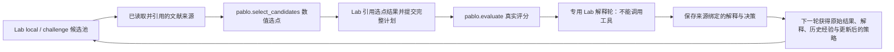

# 400 次评分之后的修复：feedback v3

本次只修改代码、文档和离线回归，没有准备或启动新实验，也没有更改已经完成的 400 次评分。旧运行继续由各自的冻结源码解释；新实现不能覆盖旧运行的源码清单后直接续跑。

## 下一轮决策的实际路径

每个评分批次必须完成自己的解释，才释放同分支、同 Lab 实例的下一轮决策。解释必须由这次专用 Lab 回答写入，绑定该批调查对象和完整来源；空更新、仅延后解释、借用其他角色的旧解释都不能释放屏障。下一轮强制携带本批调查、解释的确切版本和原始证据，不能因普通记忆检索的排序被挤掉。

这个约束也覆盖恢复和并发：已准备的工具在派发事务内再次检查屏障；旧批结果延迟发布时，下一批取消派发、按已知零成本结算，保留旧批解释任务。模型提出合法解释不代表该解释已经通过科学正确性检验。

## 内核与 PABLO 宿主的分工

| 修复 | 通用内核 `rsi_lab/` | PABLO 宿主 `experiments/pablo/` |
| --- | --- | --- |
| 逐批解释 | `batch_interpretations.py` 保存解释屏障；Runtime、Controller、角色 schema 和 preflight 接入调度、版本与派发检查 | 新配置只对 `pablo.evaluate` 启用屏障；收尾不能绕过未解释批次 |
| Scientific Memory 检索 | 当前结果与历史经验分别获得可用预算，空余可互借；按来源关联、文本相关性、负结果及版本排序；强制对象及完整来源超预算时明确阻塞 | 领域投影提供分子身份、结果和经验的科学含义；不把 SMILES 规则写进内核 |
| 停滞调整与 Lab Harness | 提供持久执行、工作占用与解释顺序，不判断分数方向 | `harness.py` 恢复原 local/challenge 分工与节奏；用实际评分回执推进轮次并分配信用 |
| 可执行文献方法 | Adapter 新增可选 `required_evidence`：要求原文事实完整交付并被命令引用；保留通用执行契约检查 | `methods.py` 实际计算多样性选点或 kNN acquisition；评分只接受成功发布计划中的完整候选集合 |
| Meta→Lab | 建议参数契约、来源、版本、采纳和实际完成仍由通用闭环核验 | 方法参数、角色、anchor、计划 ID 和真实评分覆盖由领域回调核验；支持对实际选点工具提出建议 |

本轮没有改动 PABLO 评分函数，也没有把分子算法加进内核。`work_claims.py`、`decision_dependencies.py`、`result_signals.py` 和建议额度拆分等属于此前已完成的修复；本轮在这些机制上接入解释与方法执行。完整回归另外暴露并修复了 JSON 契约深度校验依赖 Python 递归异常的问题，现显式限制深度 32、节点 8,192 和大小 64 KiB。

## 策略与方法的具体边界

恢复的 Lab 策略为三批 local 后一批 challenge；连续四批未改善时，增加奇数轮 challenge。新增宿主规则还检查连续 40 个评分无改善，触发同样的交替模式；继承数据中的停滞会计入。严格超过历史最好分数才重置停滞计数。lookup、选点预测和模型调用不能冒充评分进展。

挑战批次实际候选必须离开当前最佳骨架系列；local 候选必须满足与已观测 anchor 的相似度下限。没有可用不同系列 anchor 时明确阻塞。来源版本、原策略与新增约束的区别见 [HARNESS.md](pablo_task/HARNESS.md)。

文献方法现在有两个受限、实际计算的实现：

- `fingerprint_diversity`：按 Morgan 指纹距离贪心选择不同于历史及本批已选分子的候选。
- `knn_ucb_diversity`：从完整已观测历史计算加权 kNN 均值，加上不确定性代理和多样性项选点。

第二项的不确定性没有经过校准，不是 Gaussian-process 后验；两项都不是任意论文的自动复现。必须有适用主题且包含摘要的真实文献结果；空检索、仅元数据或未交付/未引用的来源不能支撑执行。工具保存实际参数、训练集与候选池 hash、数值结果和局限。随后评分绑定同一计划、角色与 anchor，拒绝替换、缺漏、重复和过期候选。具体输入与算法见 [METHODS.md](pablo_task/METHODS.md)。

## 配置与验证

新准备的宿主使用 `pablo_research_pr4_feedback_v3`，冻结 `pablo_harness` 和 `batch_interpretation_capabilities=["pablo.evaluate"]`，注册第四个工具 `pablo.select_candidates`。v3 缺少 Harness 或解释屏障会在启动前被拒绝。没有新配置的旧运行保留旧工具契约；这不豁免其冻结源码校验。

主要回归覆盖：

- 内核：解释后再决策、完整来源与固定解释版本、无效更新拒绝、不同 Lab 实例隔离、延迟发布与派发竞争、崩溃恢复、真实 CodexExecutor 的解释 schema。
- 记忆：相关历史经验和负结果不被 pending 调查淹没，强制对象及来源的字节预算保持有效。
- 宿主：原 local/challenge 节奏、两种停滞阈值与重置、继承停滞、真实候选约束、按实际结果记账、方法数值计算与选点计划核验。
- 全链路：合成模型回答、明确标记的合成文献和评分桩，经过真实 Runtime 完成选点 → 评分 → 解释 → challenge；没有调用真实模型或启动优化实验。

离线回归证明执行约束及数据交付成立，不证明这些方法能提高最佳分数；性能效果仍需后续获准的新实验测量。

最终全量验证：内核 **639/639**、PABLO **145/145** 通过；命令、覆盖范围及旧账本 hash 见[验收记录](../../reports/pr4-research-verification/feedback-v3-validation.md)。
