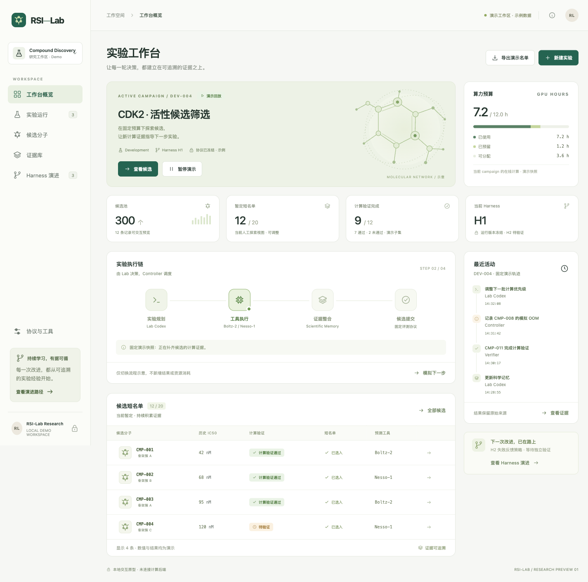

# RSI-Lab 前端原型

中文科研工作台，使用 HTML、CSS 和 JavaScript 模块实现。无第三方运行依赖，不需要安装软件包。



[手机布局预览](docs/mobile.png) · [设计说明](DESIGN.md) · [验证记录](QA.md)

## 本地预览

需要 Node.js 20 或更高版本：

```sh
cd frontend
npm run dev
```

打开 `http://127.0.0.1:4173`。端口可通过 `PORT` 环境变量调整。

```sh
npm run check
npm run build
```

构建会生成可独立打开的 `dist/index.html`，可直接用浏览器打开，不需要后端或外部字体。构建产物不纳入 Git。

## 页面与交互

- **工作台概览**：当前 campaign、分项预算、流程示意、短名单与执行轨迹。
- **实验运行**：独立 campaign 元数据，创建仅保存在本地浏览器的实验草稿。
- **候选分子**：按编号、骨架或工具搜索，按验证状态筛选、按 IC50 排序；查看详情、调整和锁定名单、导出带 `isDemo` 标记的 JSON。
- **证据库**：分类型查看测量、模型预测、计算验证和执行失败；通过证据 ID 打开来源记录。
- **Harness 演进**：H0、H1 与 H2 候选的机制差异、验证状态及固定发布规则。

支持桌面、平板、手机布局，以及键盘导航、原生对话框和减少动态效果偏好。可以在右上角“关于此原型”中重置本地演示。

## 数据边界

所有候选、测量、预测、计算结果、预算、时间和版本记录均为虚构演示数据。CDK2 仅为示例靶点，正式靶点尚未确定。界面不运行 Codex，不调用 Boltz-2、Nesso-1 或验证器，也不会启动 GPU 任务。

当前候选与证据视图固定对应 `DEV-004` 的 12 条演示记录；其他 campaign 仅展示独立元数据。演示预测分并非模型原生输出，不用于跨工具排序。OOM 显示为执行失败与未知结果，不解释为分子无活性。锁定与导出均是本地交互，不构成正式实验提交。

名单、草稿及流程示意状态保存在浏览器 localStorage。固定证据不被这些操作修改；H2 不会替换活动 campaign 的 H1。

## 文件组织

```text
index.html           页面入口
src/app.js           页面、交互与本地状态
src/styles.css       视觉风格与响应式布局
src/data.js          明确标注的演示数据
src/icons.js         本地 SVG 图标
server.mjs           仅监听本机的预览服务器
scripts/build.mjs    生成独立 HTML 预览
DESIGN.md            信息结构与设计说明
```

后续接入真实系统时，应由后端提供分支隔离、预算准入、证据存储、名单提交与发布判定；当前前端状态不是这些约束的安全实现。
