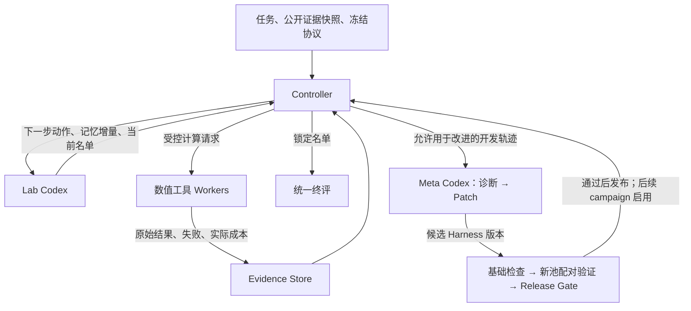

# RSI-Lab：Codex 编排、Prompt 与消息传递

本文是 [v2 实验方案](../RSI-Lab_Experiment_Plan_v2_zh.md) 的实现设计附件。当前交付是架构、prompt 模板和消息示例，尚未实现调度器、启动模型调用或运行生物计算。所有示例数值均为虚构的消息演示，不是实验结果。

**1. 推荐结构：一个控制程序、两个核心 Codex 角色**

第一版使用 Lab Codex 和 Meta Codex 两个逻辑角色，复用同一个冻结的底座模型。一个角色可以对应多次独立 Codex 调用，不需要常驻一个永不结束的会话。

| 组件 | 是否使用 Codex | 主要职责 | 输出交给谁 |
|---|---|---|---|
| Controller 编排器 | 否，普通程序 | 维护状态、组装输入、校验输出、预留预算、投递任务、提交名单 | Codex、执行队列、验证程序 |
| Lab Codex | 是，campaign 内运行 | 选择候选和工具、解释反馈、维护工作记忆与当前 shortlist、判断停止 | Controller |
| Tool Workers / Evaluator | 否，确定性适配器调用实际工具 | 运行 Boltz-2、Nesso-1 或 verifier，记录原始结果、状态和成本 | Controller / Evidence Store |
| Meta Codex | 是，campaign 之间运行 | 分阶段诊断开发轨迹、生成 Harness 提示或代码 patch | Controller / 候选版本目录 |
| Validator / Release Gate | 否，固定程序 | 基础检查、配对验证、计算发布条件、登记新版本 | Release Registry |
| Evidence Store / Memory Store | 否，存储服务或文件 | 分开保存不可变证据和可修订工作记忆 | Controller 提供受控读取 |

Lab Harness 是应用侧的提示模板、上下文组织、记忆规则和工具决策机制；Codex 是运行这些任务的 agent 执行环境。Meta 修改应用侧 Harness，不修改 Codex CLI 本身、模型权重或外部评分器。



“控制程序”只负责执行协议和资源边界，不替 Lab Codex 选择科学上更有希望的分子；最终质量和发布判定也不由 Codex 自评。

**2. 每次调用收到什么**

每次调用的输入按三部分构造：

`固定实验约束 + 当前角色模板 + 本次结构化输入`

固定约束见 [common_contract.md](prompts/common_contract.md)，定义证据、预算、隔离和输出约定；角色模板规定本次要做的工作；本次输入由 Controller 从权威记录中生成。

这些是应用逻辑上的分层。CLI 可将三部分拼接为一个 stdin prompt，不能据此假定 CLI 暴露了独立的 system-prompt 参数。权限仍由运行环境与受控工具接口落实。

| Lab 输入 | 内容 | 用途 |
|---|---|---|
| task_spec | target、候选池、k、优化目标、允许动作、当前阶段 | 知道要完成什么 |
| protocol_ref | 不可修改的协议版本、输出定义与约束 | 保证任务目标一致 |
| tool_catalog | 工具 ID、参数格式、输出含义、成本估计、可用状态 | 选择可执行计算 |
| budget_snapshot | 剩余 GPU/CPU/LLM/时长预算及已预留额度 | 判断请求是否值得提出 |
| memory_snapshot | 当前排序、策略记录、冲突、未决问题 | 延续工作状态 |
| recent_tool_results | 上一批新结果、失败、实际费用及 evidence_id | 根据新证据调整策略 |
| evidence_index | D0 和本分支结果的摘要及可读取引用 | 核对依据，避免只依赖摘要 |
| current_shortlist | 随时可提交的名单，初始时可为空 | 预算耗尽时仍有确定输出 |

不必每次重发所有 SDF、蛋白文件或全量日志。传递必要摘要、来源 ID 与可读取的 artifact 引用；Codex 请求补充证据时，Controller 返回相应原始片段并记录读取。证据只能来自共同 D0 或本分支已经产生的记录。

**3. 单个 campaign 的实际消息顺序**

1. Controller 建立分支，加载同一 D0、H0 或 H*、预算和初始记忆。每个方法、pool、seed 都有独立分支 ID。
2. Controller 组装 prompt，调用 Lab Codex，取得一个结构化决策。
3. Lab 返回 `tool_batch`、`read_evidence` 或 `submit`。每次同时返回当前 shortlist、记忆增量和简短依据；它不直接执行 GPU 工具。
4. Controller 检查候选 ID、工具参数、快照版本、预算和重复请求。无效请求返回结构化拒绝原因，修复调用也计费；拒绝本身不能替 agent 改选候选。
5. 对合法 tool_batch，Controller 按冻结 profile 的可强制执行资源上限原子预留预算并生成 job，不能仅凭平均耗时估计准入。互不依赖的计算可并行；使用有序批次同步点汇总结果后再让 Lab 决策，以减少完成顺序噪声。
6. Workers 执行固定命令，原始结果追加进 Evidence Store，Controller 按实际费用结算，产生新的预算和记忆版本。
7. Lab 接收最新结果与状态，调整策略并重复；模型说“已验证”不构成结果，只有 evaluator 的记录构成证据。
8. Lab 提交，或外部资源上限触发收尾。Controller 锁定最后一次合法 shortlist；不足 k 项按 v2 评分规则保留缺项，不在看到终评后补选。
9. 统一终评生成该批次的官方候选—协议结果表。开发批次进入允许的改进历史；final 批次不进入本次 Meta 改进。

当前名单在正常调用中持续维护，不额外安排一个未计费的“最终总结 agent”。如果资源不足以再调用 Lab，Controller 可按已有结构化内容渲染报告，并明确哪些位置缺失。

预算字段统一约定：`remaining` 表示总上限减去已结算费用，尚未扣除 `reserved`；新请求可用额度是 `remaining - reserved`。执行器落实超时、取消及资源截断，结算成功、失败、取消和截断任务的实际费用，再释放预留。预留需覆盖终止延迟；无法强制限制的资源不得被表述为严格硬上限。

**4. 相互传递的是五类信息**

| 信息 | 谁产生 | 内容和权威性 |
|---|---|---|
| action_request | Lab Codex | 想执行什么、选谁、用哪个工具、依据是什么；只是请求 |
| tool_result | Worker / Evaluator | 实际执行状态、结果、原始文件、成本；模型不可自行填造 |
| memory_delta | Lab，或可选 Evidence Analyst | 带来源的解释、冲突、策略更新和假设；经结构校验后更新工作记忆 |
| diagnostic / patch | Meta Codex | 机制问题与证据、一个具体修订；尚未验证的候选变化 |
| validation_result / release_decision | Validator / Gate | 配对成绩、成本、规则判断与版本记录；决定是否发布 |

`evidence_id` 是对不可变证据记录的引用，不是结论。`memory_delta` 改变本轮已知状态或解释；`patch` 改变未来运行怎样处理输入、更新记忆和作决策。一次工具失败、一次更换候选都不自动构成 Harness 自改进。

**消息公共字段。** Controller 给消息附加 `schema_version`、`message_id`、`batch_id`、`campaign_id`、`branch_id`、`phase`、`harness_version`、`protocol_hash`、`snapshot_id`、`state_version`、`sender`、`recipient`、`parent_message_id`。模型只返回业务 payload 与输入 state_version，身份、时间和权威费用不由模型自由填写。

这些字段使日志可关联，也防止上一个版本/分支的结果被误接到当前运行。模型输出的 state_version 过期时应退回新快照，不能悄悄按旧预算执行。动作去重键为 `(branch_id, request_id)`，同时保存规范化请求的 hash：同键同内容返回既有状态，同键不同内容拒绝，不因消息重投重复付费。Lab 的 request_id 应在本分支内唯一，可用输入 state_version 与本轮序号组合；实际 job ID 由 Controller 分配。

下方示例展示 Lab 的返回 payload，配套完整输入在 [lab_turn_input.example.json](examples/lab_turn_input.example.json)，输出在 [lab_turn_output.example.json](examples/lab_turn_output.example.json)。示例为 N=3、k=2 的消息演示，非正式实验规模。

```json
{
  "input_state_version": 0,
  "next_action": "tool_batch",
  "reason_brief": "已有 IC50 接近，补充两个不同结构簇候选的预测信号。",
  "evidence_ids": ["ev_ic50_A", "ev_ic50_B"],
  "tool_requests": [{
    "request_id": "req_001",
    "tool_id": "nesso_affinity",
    "candidate_ids": ["cmp_A", "cmp_B"],
    "parameter_profile": "nesso_frozen_v1"
  }],
  "read_evidence_ids": [],
  "memory_delta": [],
  "shortlist": [
    {"candidate_id": "cmp_A", "evidence_ids": ["ev_ic50_A"], "uncertainty": "尚无新计算验证"},
    {"candidate_id": "cmp_B", "evidence_ids": ["ev_ic50_B"], "uncertainty": "尚无新计算验证"}
  ],
  "open_questions": ["新模型信号是否支持当前排序？"],
  "stop_reason": null
}
```

Worker 返回的是另一类结构，例见 [tool_result.example.json](examples/tool_result.example.json)。其中 cost、output、status 由运行系统写入，不能从 Codex 文本中提取一个自报数字当作实际消耗。`evaluator_pass` 对普通预测任务为空；预测分数不会自动转成固定 verifier 的通过标签。

示例中的 `demo_affinity_score` 只演示消息结构，并非 Nesso 的实际原始字段。正式 tool_catalog 必须明确各工具输入格式、实际输出字段、单位、分数方向和版本；缺少定义时保存原值并标记不可用于排序，不能由 Codex 猜测含义。不同工具的数值不能只因名称相近就混合排序。`artifact://` 也只是本设计约定的引用示例，实现时需由 Controller 解析为授权可读产物。

**5. 跨 campaign 的 Meta 编排**

Meta 使用“诊断”和“修改”两个阶段的 prompt。它们可以由同一底座模型分别执行；建议通过显式 diagnostic 文件交接，使改动依据可审查，而不是仅依赖聊天历史。

| 步骤 | 输入 | 输出 | 接收方 |
|---|---|---|---|
| Diagnose | 当前 Harness、允许的开发轨迹、成本/失败指标、既有 patch 记录 | 一个优先机制问题、证据引用、待验证假设；也可 no_change | Controller |
| Patch | 冻结的诊断、父版本代码和提示、允许修改范围、基础检查清单 | 单个 patch、修改文件列表、预期收益、退化风险、检查结果引用 | 候选版本存储 |
| 基础检查 | 候选差异、固定接口及约束 | 是否越权、接口能否运行、日志/预算是否保持有效 | Validator |
| 配对验证 | 当前发布版和候选版、新 validation pool、相同 D0 | 每池/seed 的质量、费用、可靠性指标 | Release Gate |
| 发布 | 验证结果和预先冻结门槛 | 发布或拒绝、理由、版本 hash | 下一轮 Controller |

Gate 执行 v2 的两条预登记路径：质量提升，或质量在容差内且成本下降。Meta 不能自己写“实验成功”然后直接替换当前版本。每轮上限、验证重复数和总费用由 Controller 管理；失败 patch、拒绝版本及格式修复也有成本和轨迹。

Patcher 在候选副本中工作，只能改允许的应用 Harness 文件，例如 `harness/policy/`、`harness/memory_views/`、`prompts/lab/`。不能改 evaluator、预算器、release gate、固定接口、原始数据或 final 结果；也不能把某个候选 ID 或答案硬编码进策略。

已经开始的 campaign 始终绑定原 Harness hash，发布只影响后续运行。验证结果公开后可用于下一轮诊断，但下一轮使用新 validation pool；最终 H* 冻结后不再运行 Meta 修改。

**6. Prompt 模板：如何拼装和使用**

可直接作为实现起点的文件：

| 文件 | 什么时候用 | 本次 payload |
|---|---|---|
| [common_contract.md](prompts/common_contract.md) | 每次调用固定附加 | 协议、阶段、来源与权限边界 |
| [lab_planner.md](prompts/lab_planner.md) | 每次 Lab 决策 | task、tools、budget、memory、recent results |
| [meta_diagnose.md](prompts/meta_diagnose.md) | 开发 campaign 结束后 | 开发轨迹与版本历史 |
| [meta_patch.md](prompts/meta_patch.md) | 诊断已确定后 | diagnostic、父版本代码、修改白名单 |
| [evidence_analyst_optional.md](prompts/evidence_analyst_optional.md) | 需要拆出证据整理时 | 原始证据、已有记忆、待检查陈述 |
| [explorer_optional.md](prompts/explorer_optional.md) | 需要拆出覆盖探索时 | 当前池、覆盖情况、既有结果与预算摘要 |

主流程先用 Lab 模板统一完成规划和解释。若拆出 Analyst：工具结果 → Analyst 生成 memory_delta → Controller 校验入库 → Lab 决策。若拆出 Explorer：先提出候选/工具建议，再交 Lab 选择；Explorer 本身不占用数值工具预算，也不能自动启动计算，其 LLM 消耗仍计费。

这些额外角色不是免费能力。H0/H* 应使用相同基础组件和相同资源上限；若 Meta 自动改变了调用次数或角色组织，应记录为具体 patch 并纳入验证，不能把 H* 独享的额外 token 当作纯机制收益。

**7. Codex 调用与会话生命周期**

目前本机只读检查确认 `codex-cli 0.163.0` 的 `exec` 支持 stdin prompt、`--json`、`--output-schema`、`--output-last-message`、`--ephemeral` 和沙箱设置。官方文档说明 `--json` 输出事件流，`--output-schema` 约束最终响应结构；这是两个不同层次，业务消息仍需 Controller 校验。[Non-interactive mode](https://learn.chatgpt.com/docs/non-interactive-mode)

推荐第一版用 **Python Controller 调用 codex exec**：生物工具和日志容易统一管理。下面仅为接口示意，schema、prompt.rendered.txt、运行目录及真正的隔离环境需实现后生成；本次没有执行该命令。

```sh
codex exec \
  --sandbox read-only \
  --ephemeral \
  --json \
  --output-schema /isolated/run/lab_response.schema.json \
  --output-last-message /isolated/run/lab_response.json \
  - < /isolated/run/prompt.rendered.txt \
  > /isolated/run/codex.events.jsonl
```

默认一次决策一次独立调用，外部科学记忆保证连续性；保留已渲染 prompt、结构化响应与必要事件记录便于审计。不要为了“共享上下文”让 H0、H*、不同 pool 或 development/final 共用同一聊天历史。

也可以通过 Codex SDK 启动并继续会话。官方 TypeScript SDK 支持 startThread、同线程继续 run 及按 ID 恢复；若采用持久会话，thread ID 必须绑定 method/pool/seed/Harness 版本，同一线程上的轮次串行执行。跨 campaign 重建会话，通过公开 D0 传递经验。[Codex SDK](https://learn.chatgpt.com/docs/codex-sdk)

“不同线程”“不同工作目录”和“read-only”均不自动保证数据读取隔离。正式比较需由运行环境只暴露该分支的 D0、代码版本和产物，并限制工具访问；昂贵计算通过 Controller 的执行接口进入。不能仅在 prompt 中写“不要读其他分支”，却把所有结果挂在可读文件系统里。候选代码的基础检查也应在隔离副本执行，不能触达 final 数据或修改权威账本。

H0/H* 固定相同的 Codex 版本、底座模型及可用配置，记录会影响行为的项目指令、skills、工具定义和配置 hash。模板文件放在本设计附件下，不会自动成为项目 AGENTS.md 或自动启用的 skill。

CLI 消耗和数值工具消耗分别记录。每次 Codex 调用前检查并预留 LLM 预算，结束或失败后按实际事件结算；不能仅用 prompt 声称硬限制 token。若所选接口无法强制单次 token/费用上限，须记录该限制，使用可实现的超时/调用限制和预算预留控制，并如实报告超额。

**8. 状态与文件职责**

后续实现可按下列结构组织；这是应用目录建议，本次仅创建了文档、prompt 与 examples。

```text
controller/                # 冻结的状态机、路由、预算与提交机制
evaluator/                 # 固定工具适配和官方评测
protocols/                 # 冻结协议、消息schema、发布条件
harness/policy/            # Meta允许修改的决策机制
harness/memory_views/      # Meta允许修改的派生记忆组织
prompts/lab/               # 随Harness版本发布的Lab模板
prompts/meta/              # 本次实验中冻结的Meta模板
evidence/                  # 权威、追加式原始证据
runs/<branch>/memory/      # 分支私有工作记忆、策略、候选排序
runs/<branch>/messages/    # 输入包、输出payload、请求与结果关联
releases/                  # 候选补丁、验证、接受/拒绝记录
```

Controller 是权威记录的单一写入者，Workers 通过结果接口登记输出。Lab 的 memory_delta 采用版本化更新：更正解释时保留被替代条目的引用，不删除原始证据；不允许用修改工作记忆的方式改动成本、官方成绩或数据身份。

短名单校验、schema 校验和引用存在性检查只能证明格式与来源可达，不能证明推理正确。科学解释仍需保留不确定性，并按 v2 的独立审计规则复核。

**9. 一次完整运行的阅读示例**

1. Controller 告诉 Lab：有三个候选，选两个，公开 IC50 都可读；当前没有新模型结果。
2. Lab 请求对 A、B 使用同一个冻结 Nesso profile，并给出暂定名单 A、B。
3. Controller 校验并预留费用。Worker 对 A 成功返回预测，对 B 发生 OOM；两项实际成本均记录，OOM 不等于 B 无活性。
4. Lab 收到结构化成功/失败记录，将 A 的预测记为模型证据、B 的状态记为执行失败。它可以调整下一步工具或改选候选，也可以按剩余额度停止；未运行的 verifier 标签仍未知。
5. shortlist 锁定后，统一 evaluator 补齐官方验收。本批结束后归档。
6. 如果这是开发批次，Meta Diagnoser 可从多个事件定位重复 OOM 重试；Patcher 提出失败分类或重试策略修改，当前 campaign 不受影响。
7. Validator 在新 pool 上比较候选版与当前版，Gate 按固定质量/成本条件决定是否发布。下一 campaign 才开始使用新版本。

固定 Harness H0 也会做第 4 步的在线调整；只有经第 6–7 步验证后改变未来处理机制，才属于本项目要检验的跨 campaign 改进。
